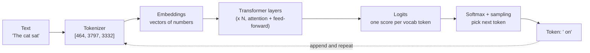
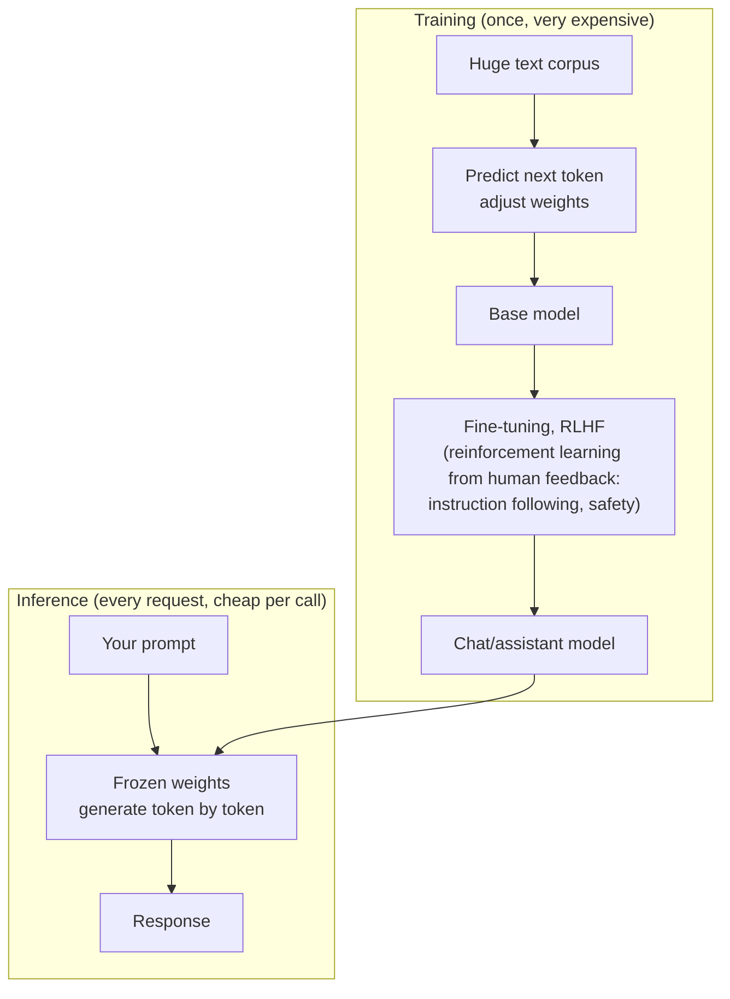

# 00 · Orientation: The Mental Model

## Key idea
A **Large Language Model (LLM)** is a function that takes a sequence of **tokens** and returns a **probability distribution over the next token**. Everything else (chat, code generation, tool use) is built by calling that function in a loop.

## Intuition
Think of autocomplete on a vast scale. Your phone predicts the next word from the last few words. An LLM predicts the next token from thousands (now often hundreds of thousands) of previous tokens, using billions of learned numbers (**parameters**, or weights) that were tuned by reading a huge amount of text.

To predict text well, the model had to pick up grammar, facts, coding patterns and some reasoning-like behavior. That is why a "just predict the next token" objective yields useful behavior. It is also why the model can be confidently wrong: it optimizes for *plausible* continuations, not *verified* ones.

## How it works: the pipeline



| Stage | What happens | Handout |
|---|---|---|
| Tokenizer | Text is split into sub-word pieces mapped to integer IDs | 02 |
| Embeddings | Each ID becomes a vector that encodes meaning | 02 |
| Transformer layers | Tokens exchange information (attention) and are transformed by a feed-forward network (**MLP**, multi-layer perceptron) | 03 |
| Logits → probabilities | A score for every token in the vocabulary becomes a probability | 04 |
| Sampling | One token is chosen, appended to the input, and the loop repeats | 04 |

## Two phases of an LLM's life


Key consequence: **at inference time the weights do not change.** The model does not "learn" from your conversation. Anything it appears to remember comes from the text in its **context window**.

## Pseudo-code: the whole thing in 8 lines
```text
function generate(prompt, max_new_tokens):
    tokens = tokenize(prompt)
    repeat max_new_tokens times:
        probs = model(tokens)        # distribution over next token
        next  = sample(probs)        # e.g. with temperature
        if next == END_OF_TEXT: break
        tokens.append(next)
    return detokenize(tokens)
```

## Example: a toy "language model" in Python
A bigram model is the simplest next-token predictor. It only looks at the single previous word, but the *interface* is identical to an LLM's.

```python
import random
from collections import defaultdict, Counter

text = "the cat sat on the mat the cat ate the fish".split()

# "Training": count which word follows which
counts = defaultdict(Counter)
for a, b in zip(text, text[1:]):
    counts[a][b] += 1

def next_word(prev):
    options = counts[prev]
    words, weights = zip(*options.items())
    return random.choices(words, weights=weights)[0]   # sample from distribution

# "Inference": generate
word, out = "the", ["the"]
for _ in range(6):
    word = next_word(word)
    out.append(word)
print(" ".join(out))
```

An LLM replaces the lookup table `counts` with a neural network that can use the *entire* preceding context, and generalizes to sequences it has never seen.

## Pitfalls
- **"It understands like a person."** Treat it as a powerful pattern model. Useful, but it has no guarantee of truthfulness.
- **"It learns from my chat."** Not in the weights. Only the context window carries state.
- **"Same prompt, same answer."** Sampling is random by default, so outputs vary (see handout 04).
- **"Words are the unit."** Tokens are. Costs, limits and some odd failures (counting letters) follow from that (see handout 02).

## Summary
- LLM = next-token probability function, called in a loop.
- Pipeline: tokenize → embed → Transformer layers → logits → sample.
- Training changes weights. Inference does not.
- Context window is the model's only working memory.

## Further reading
- Karpathy, [*Intro to Large Language Models*](https://www.youtube.com/watch?v=zjkBMFhNj_g) (video, 1 hour)
- Jay Alammar, [*The Illustrated GPT-2*](https://jalammar.github.io/illustrated-gpt2/)
- [*LLM Visualization*](https://bbycroft.net/llm): an interactive 3D walkthrough of the same pipeline (tokens, embeddings, Transformer layers, softmax)
