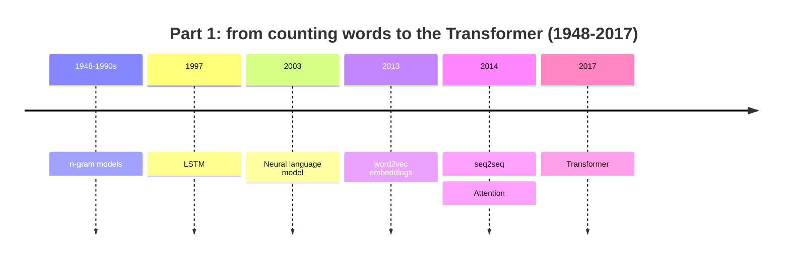
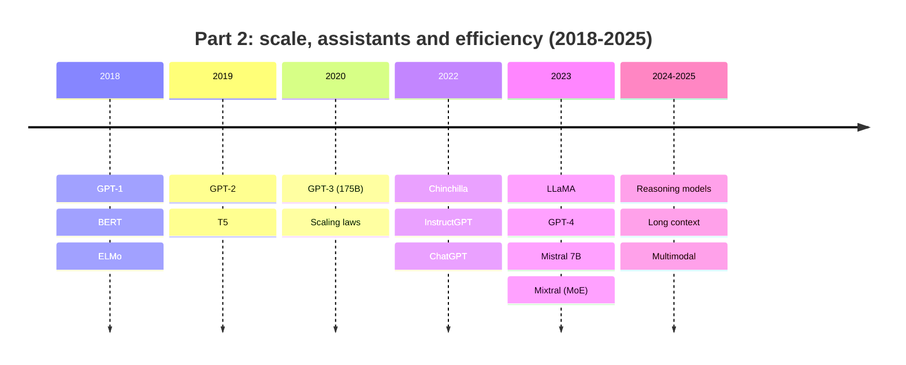
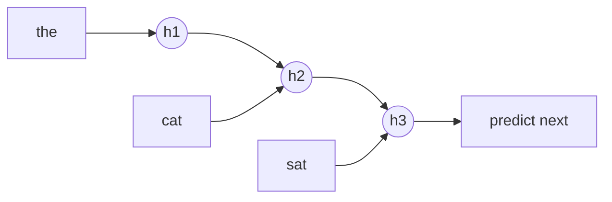

# 01 · A Short History of Language Models

## Key idea
Language modeling (predicting the next word) is old. What changed is *how* we model context and *how much* data and compute we throw at it. The 2017 Transformer made context handling parallelizable, which unlocked scale, and scale produced today's LLMs.

## Timeline

Key papers behind Part 1: LSTM (Hochreiter and Schmidhuber), neural language model (Bengio et al.), seq2seq (Sutskever et al.), attention (Bahdanau et al.), Transformer ("Attention Is All You Need", Vaswani et al.). The sections below explain each step.

## Era by era

### 1. Counting (n-grams)
Predict the next word from the previous *n-1* words using counted frequencies (the toy bigram model in handout 00 is an n-gram model).
- **Strength:** simple, fast.
- **Limits:** the table explodes as $n$ grows, and unseen sequences get zero probability. It cannot capture long-range context or similarity ("cat" and "kitten" are unrelated symbols).

### 2. Neural models and embeddings
Bengio et al. (2003) predicted the next word with a neural network over *learned vectors* for words. word2vec (2013) made embeddings popular: similar words get nearby vectors. This solved the similarity problem and generalized to unseen phrases.

### 3. Recurrent networks (RNN, LSTM, GRU)
**RNNs** (recurrent neural networks) and their gated variants **LSTM** (long short-term memory) and **GRU** (gated recurrent unit) read the sequence one token at a time, carrying a **hidden state** (a fixed-size memory).

- **Strength:** handles variable-length context in principle. LSTM/GRU gating helped remember longer.
- **Limits:** (a) inherently **sequential**, so training cannot be parallelized across positions; (b) a fixed-size state is a **bottleneck**; (c) information from far back fades (vanishing gradients).

### 4. Seq2seq and attention (2014)
Translation models used an encoder RNN to compress the source sentence into one vector, then a decoder RNN to generate the target. Compressing everything into one vector hurt long sentences. **Attention** (Bahdanau et al.) let the decoder *look back at all encoder states* and weight the relevant ones at each step. Attention was the idea that kept growing.

### 5. The Transformer (2017)
Vaswani et al. asked: if attention is doing the heavy lifting, drop the recurrence. A Transformer processes all tokens **in parallel**, with attention letting every token look at every other token directly.

| | RNN/LSTM | Transformer |
|---|---|---|
| Processing | sequential | parallel across positions |
| Long-range links | through many steps (fades) | one attention hop |
| Training speed on GPUs | slow | fast, scales well |
| Cost | $O(n)$ per step, sequential | $O(n^2)$ attention in sequence length |

Parallelism is the practical reason this architecture won: it let people train much bigger models on much more data (details in handout 03).

### 6. Pretrain once, adapt many times (2018-2019)
Instead of training a model per task, **pretrain** a big model on raw text, then adapt it.
- **GPT-1/2** (Generative Pre-trained Transformer; decoder-only): predict the next token. GPT-2 showed text generation and zero-shot ability emerging with scale.
- **BERT** (Bidirectional Encoder Representations from Transformers; encoder-only): fill in masked words. Excellent for understanding tasks (classification, search) rather than generation.
- **T5** (Text-to-Text Transfer Transformer; encoder-decoder): cast every task as text-to-text.

These three branches are the architecture families classified in handout 03.

### 7. Scaling (2020-2022)
- **GPT-3 (2020):** 175B parameters. Showed **in-context (few-shot) learning**: put examples in the prompt, no weight updates needed.
- **Scaling laws (Kaplan et al., 2020):** loss falls smoothly and predictably as parameters, data and compute grow.
- **Chinchilla (Hoffmann et al., 2022):** many models were *under-trained*. For a given compute budget, parameters and training tokens should grow together (roughly 20 tokens per parameter was the rule of thumb). This shifted focus to more data per parameter.

### 8. From text predictor to assistant (2022)
A base model continues text. It does not follow instructions. **Instruction tuning** plus **RLHF** (reinforcement learning from human feedback; InstructGPT, 2022) taught models to follow requests and prefer helpful, safe answers. ChatGPT (Nov 2022) packaged this and drove mass adoption. Handout 05 covers the training recipe.

### 9. Open models, efficiency, reasoning (2023-)
- **Open-weight models:** LLaMA (2023) and successors, Mistral, and others made capable models runnable locally and fine-tunable by anyone.
- **Efficiency:** **Mixture of Experts** (MoE, e.g., Mixtral) activates only part of the network per token; quantization and better serving shrink cost (handouts 06, 07).
- **Reasoning models (2024-):** models trained (often with reinforcement learning) to produce long intermediate "thinking" before answering, trading more inference compute for better results on hard problems (e.g., OpenAI o1, DeepSeek-R1).
- **Multimodal and long context:** images, audio and much larger context windows became routine.

*Dates and model names are as of late 2026 and this part of the field moves fast. Verify before citing.*

## Recurring patterns in the history
1. **Replace hand-built structure with learned structure** (counts → embeddings → learned attention).
2. **Whatever parallelizes on GPUs wins** (RNN → Transformer).
3. **Scale up, then adapt** (pretrain big, specialize cheaply).
4. **Base capability, then alignment** (predict text, then shape behavior).
5. **Move compute around** (more at training, then more at inference via reasoning).

## Pitfalls
- "Transformers were invented with ChatGPT." No: 2017 architecture, 2022 product.
- "Bigger is always better." Chinchilla showed data and compute balance matter; smaller well-trained models often beat larger under-trained ones.
- "Attention is new in 2017." It appeared in 2014 as an add-on to RNNs; 2017 made it the whole architecture.

## Summary
- n-grams → neural language models → RNN/LSTM → attention → Transformer → scaled pretraining → aligned assistants → efficient, open and reasoning models.
- The Transformer's parallelism enabled scale. Scale and alignment produced today's LLMs.

## Further reading
- Vaswani et al., [*Attention Is All You Need*](https://arxiv.org/abs/1706.03762) (2017)
- Bahdanau et al., [*Neural Machine Translation by Jointly Learning to Align and Translate*](https://arxiv.org/abs/1409.0473) (2014)
- Kaplan et al., [*Scaling Laws for Neural Language Models*](https://arxiv.org/abs/2001.08361) (2020)
- Hoffmann et al., [*Training Compute-Optimal Large Language Models*](https://arxiv.org/abs/2203.15556) (Chinchilla, 2022)
- Ouyang et al., [*Training language models to follow instructions with human feedback*](https://arxiv.org/abs/2203.02155) (2022)
- Jay Alammar, [*The Illustrated Word2vec*](https://jalammar.github.io/illustrated-word2vec/) (a visual explanation of the 2013 embedding breakthrough)
