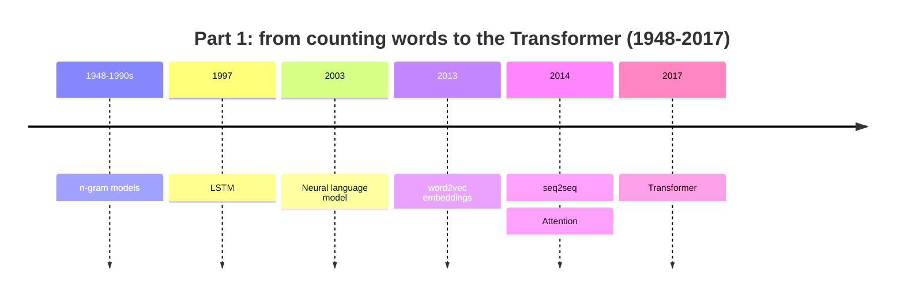
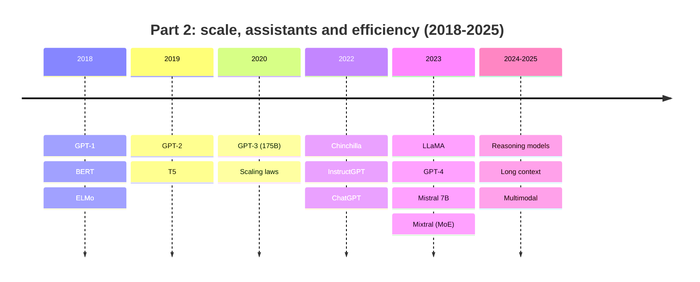
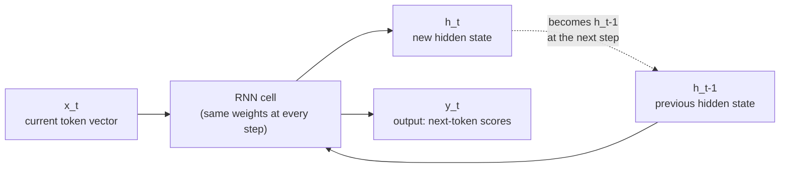
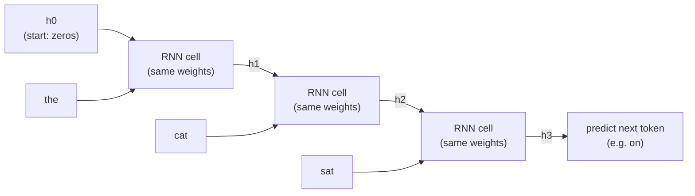
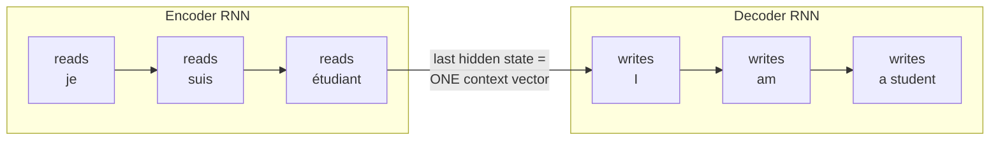
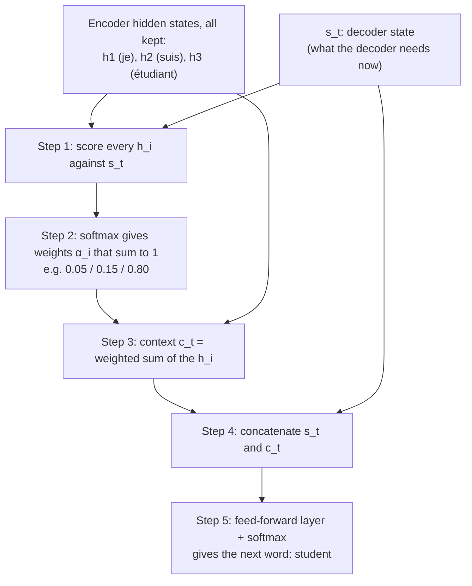

# 01 · A Short History of Language Models

## Key idea
Language modeling (predicting the next word) is old. What changed is *how* we model context and *how much* data and compute we throw at it. The 2017 Transformer made context handling parallelizable, which unlocked scale, and scale produced today's LLMs.

## Timeline





Key papers behind Part 1: LSTM (Hochreiter and Schmidhuber), neural language model (Bengio et al.), seq2seq (Sutskever et al.), attention (Bahdanau et al.), Transformer ("Attention Is All You Need", Vaswani et al.). The sections below explain each step.

## Era by era

### 1. Counting (n-grams)
Predict the next word from the previous *n-1* words using counted frequencies (the toy bigram model in handout 00 is an n-gram model).
- **Strength:** simple, fast.
- **Limits:** the table explodes as $n$ grows, and unseen sequences get zero probability. It cannot capture long-range context or similarity ("cat" and "kitten" are unrelated symbols).

### 2. Neural models and embeddings
Bengio et al. (2003) predicted the next word with a neural network over *learned vectors* for words. word2vec (2013) made embeddings popular: similar words get nearby vectors. This solved the similarity problem and generalized to unseen phrases.

### 3. Recurrent networks (RNN, LSTM, GRU)
**RNNs** (recurrent neural networks) and their gated variants **LSTM** (long short-term memory) and **GRU** (gated recurrent unit) read the sequence one token at a time, carrying a **hidden state** (a fixed-size memory).

**The idea, in everyday terms.** Imagine reading a sentence word by word while keeping a short note in your head. After each word you rewrite the note using two things: the old note and the word you just read. You can never go back and reread. Only the note remains. An RNN works exactly like this. The note is the **hidden state**, a vector of fixed length (say 512 numbers). The rewriting rule is a small network called the **cell**, and the *same* cell, with the same learned weights, is used at every step. That is what lets an RNN read a sentence of any length. At each step it also produces an output, a guess for the next token, from its current note.



**In symbols.** At step $t$ the cell takes the current token vector $x_t$ and the previous hidden state $h_{t-1}$, and produces the new hidden state $h_t$ and the output $y_t$:

$$
h_t = \tanh\!\left(W_x x_t + W_h h_{t-1} + b\right), \qquad y_t = \operatorname{softmax}(W_y h_t)
$$

- $W_x$ turns the new word into a contribution to the note, and $W_h$ decides how much of the old note is carried over. Together with the bias $b$ they are learned weights, shared by all steps.
- $\tanh$ squashes every value into the range $-1$ to $1$, which keeps the numbers from exploding.
- $W_y$ with softmax turns the note into probabilities for the next token (handout 04). During training such a prediction is made at every step, not only at the end.
- The first state $h_0$ is simply zeros.

**Unrolling in time.** To follow the information, copy the cell once per token. These are not three networks: it is the same cell with the same weights, used three times. Notice that `sat` reaches the prediction only through $h_3$, and `the` only through $h_1 \to h_2 \to h_3$.



The hidden state is a **lossy summary**: it is overwritten at every step, and the cell has no direct access to earlier tokens.

**Strengths and limits**
- **Strength:** handles variable-length context in principle, with constant memory per step.
- **Limit (a), sequential:** $h_t$ needs $h_{t-1}$, so training cannot be parallelized across positions.
- **Limit (b), bottleneck:** all history must fit into one fixed-size $h$.
- **Limit (c), fading:** each step scales old information by a factor that is typically below 1. For example $0.9^{50} \approx 0.005$, so a word 50 steps back has almost no influence. It is also hard to *learn* such long-range links, because the training signal fades the same way (the **vanishing gradient** problem).

Runnable in [`examples/python/rnn_cell.py`](../examples/python/rnn_cell.py). The demo's recurrent weights shrink the old note by a factor of 0.9 per step, so changing only the **first** token should change the final state less and less, like $0.9^{k}$ after $k$ steps. It does, while the state size never changes:

```text
state size after 3 tokens: 16 numbers (constant)
state size after 300 tokens: 16 numbers (constant)

Influence of the FIRST token on the final state:
  after  1 tokens: 0.11900   (0.9^0 x first-step change = 0.11900)
  after  5 tokens: 0.07774   (0.9^4 x first-step change = 0.07808)
  after 10 tokens: 0.04558   (0.9^9 x first-step change = 0.04610)
  after 20 tokens: 0.01566   (0.9^19 x first-step change = 0.01608)
  after 50 tokens: 0.00064   (0.9^49 x first-step change = 0.00068)
```

After 50 tokens the first word's influence is about 0.5% of what it was right after it was read, which is the $0.9^{50} \approx 0.005$ from above. (The demo uses small inputs so that $\tanh$ stays in its almost-linear range. With large inputs $\tanh$ saturates and the fade is even faster. Tests check that it is never slower than $0.9^{k}$.)

**LSTM and GRU** add **gates**: small learned switches that decide what to keep, overwrite or output, so information can travel many steps without fading. They help, but the model stays sequential with a fixed-size state. That bottleneck leads to the next section. (State-space models, handout 07, revisit this same recurrence, $h_t = A h_{t-1} + B x_t$, in a form that can be trained in parallel.)

### 4. Seq2seq and attention (2014)
**Seq2seq** (sequence-to-sequence) models, introduced for translation by Sutskever et al. and Cho et al. in 2014, use two RNNs. An **encoder** RNN reads the source sentence and compresses it into one vector, the **context vector** (its last hidden state). A **decoder** RNN then writes the target sentence word by word from that vector, feeding each word it writes back in as its next input.



Squeezing a whole sentence into one fixed-size vector is a **bottleneck**, and it hurt long sentences. **Attention** (Bahdanau et al., 2014; refined by Luong et al., 2015) removes it with two changes. First, the encoder passes **all** its hidden states to the decoder, not only the last one. Second, at every output step the decoder first works out which of them matter. The diagram shows one such step, the one that produces "student":



In symbols: the decoder's current state $s_t$ is compared with each encoder state $h_i$ to get a score, softmax turns the scores into weights $\alpha_i$, and the context for this step is the weighted sum of the encoder states:

$$
\alpha_i = \operatorname{softmax}_i\bigl(\text{score}(s_t, h_i)\bigr), \qquad c_t = \sum_i \alpha_i \, h_i
$$

A new context vector $c_t$ is built at **every** step, so when writing "student" the decoder can look straight back at `étudiant`, wherever it sits in the source. Bahdanau et al. computed the score with a small neural network. Luong et al. also proposed a simple dot product, the form the Transformer later adopted (with scaling). The diagram shows the common "concatenate" variant described by Luong et al. and used in Jay Alammar's walk-through. Bahdanau et al. instead feed the context into the decoder's state update, and their encoder reads the sentence in both directions. The core idea is the same.

**Connection to the Transformer:** this is the ancestor of the query/key/value attention in handout 03. The decoder state $s_t$ plays the role of the *query*. The encoder states $h_i$ serve as both the *keys* (what the scores are computed against) and the *values* (what gets averaged). The Transformer's key step was to drop the RNNs and keep only this mechanism. Attention was the idea that kept growing.

### 5. The Transformer (2017)
Vaswani et al. asked: if attention is doing the heavy lifting, drop the recurrence. A Transformer processes all tokens **in parallel**, with attention letting every token look at every other token directly.

| | RNN/LSTM | Transformer |
|---|---|---|
| Processing | sequential | parallel across positions |
| Long-range links | through many steps (fades) | one attention hop |
| Training speed on GPUs | slow | fast, scales well |
| Cost | $O(n)$ per step, sequential | $O(n^2)$ attention in sequence length |

Parallelism is the practical reason this architecture won: it let people train much bigger models on much more data (details in handout 03).

### 6. Pretrain once, adapt many times (2018-2019)
Instead of training a model per task, **pretrain** a big model on raw text, then adapt it.
- **GPT-1/2** (Generative Pre-trained Transformer; decoder-only): predict the next token. GPT-2 showed text generation and zero-shot ability emerging with scale.
- **BERT** (Bidirectional Encoder Representations from Transformers; encoder-only): fill in masked words. Excellent for understanding tasks (classification, search) rather than generation.
- **T5** (Text-to-Text Transfer Transformer; encoder-decoder): cast every task as text-to-text.

These three branches are the architecture families classified in handout 03.

### 7. Scaling (2020-2022)
- **GPT-3 (2020):** 175B parameters. Showed **in-context (few-shot) learning**: put examples in the prompt, no weight updates needed.
- **Scaling laws (Kaplan et al., 2020):** loss falls smoothly and predictably as parameters, data and compute grow.
- **Chinchilla (Hoffmann et al., 2022):** many models were *under-trained*. For a given compute budget, parameters and training tokens should grow together (roughly 20 tokens per parameter was the rule of thumb). This shifted focus to more data per parameter.

### 8. From text predictor to assistant (2022)
A base model continues text. It does not follow instructions. **Instruction tuning** plus **RLHF** (reinforcement learning from human feedback; InstructGPT, 2022) taught models to follow requests and prefer helpful, safe answers. ChatGPT (Nov 2022) packaged this and drove mass adoption. Handout 05 covers the training recipe.

### 9. Open models, efficiency, reasoning (2023-)
- **Open-weight models:** LLaMA (2023) and successors, Mistral, and others made capable models runnable locally and fine-tunable by anyone.
- **Efficiency:** **Mixture of Experts** (MoE, e.g., Mixtral) activates only part of the network per token; quantization and better serving shrink cost (handouts 06, 07).
- **Reasoning models (2024-):** models trained (often with reinforcement learning) to produce long intermediate "thinking" before answering, trading more inference compute for better results on hard problems (e.g., OpenAI o1, DeepSeek-R1).
- **Multimodal and long context:** images, audio and much larger context windows became routine.

*Dates and model names are as of late 2026 and this part of the field moves fast. Verify before citing.*

## Recurring patterns in the history
1. **Replace hand-built structure with learned structure** (counts → embeddings → learned attention).
2. **Whatever parallelizes on GPUs wins** (RNN → Transformer).
3. **Scale up, then adapt** (pretrain big, specialize cheaply).
4. **Base capability, then alignment** (predict text, then shape behavior).
5. **Move compute around** (more at training, then more at inference via reasoning).

## Pitfalls
- "Transformers were invented with ChatGPT." No: 2017 architecture, 2022 product.
- "Bigger is always better." Chinchilla showed data and compute balance matter; smaller well-trained models often beat larger under-trained ones.
- "Attention is new in 2017." It appeared in 2014 as an add-on to RNNs; 2017 made it the whole architecture.

## Summary
- n-grams → neural language models → RNN/LSTM → attention → Transformer → scaled pretraining → aligned assistants → efficient, open and reasoning models.
- The Transformer's parallelism enabled scale. Scale and alignment produced today's LLMs.

## Further reading
- Vaswani et al., [*Attention Is All You Need*](https://arxiv.org/abs/1706.03762) (2017)
- Sutskever et al., [*Sequence to Sequence Learning with Neural Networks*](https://arxiv.org/abs/1409.3215) (2014)
- Bahdanau et al., [*Neural Machine Translation by Jointly Learning to Align and Translate*](https://arxiv.org/abs/1409.0473) (2014)
- Luong et al., [*Effective Approaches to Attention-based Neural Machine Translation*](https://arxiv.org/abs/1508.04025) (2015)
- Jay Alammar, [*Visualizing A Neural Machine Translation Model (Mechanics of Seq2seq Models With Attention)*](https://jalammar.github.io/visualizing-neural-machine-translation-mechanics-of-seq2seq-models-with-attention/): an animated walk-through of the diagrams above
- Kaplan et al., [*Scaling Laws for Neural Language Models*](https://arxiv.org/abs/2001.08361) (2020)
- Hoffmann et al., [*Training Compute-Optimal Large Language Models*](https://arxiv.org/abs/2203.15556) (Chinchilla, 2022)
- Ouyang et al., [*Training language models to follow instructions with human feedback*](https://arxiv.org/abs/2203.02155) (2022)
- Jay Alammar, [*The Illustrated Word2vec*](https://jalammar.github.io/illustrated-word2vec/) (a visual explanation of the 2013 embedding breakthrough)
