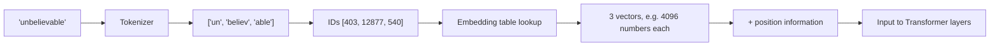
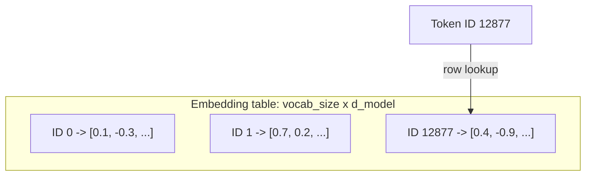

# 02 · Text to Numbers: Tokens, Embeddings, Positions

## Key idea
Neural networks only process numbers. Before an LLM sees your text, it goes through three conversions:

1. **Tokenization:** text → integer IDs (sub-word pieces)
2. **Embedding:** each ID → a vector of numbers that encodes meaning
3. **Positional information:** the model is told *where* each token sits in the sequence


*(IDs are illustrative; they differ per tokenizer.)*

---

## Part 1: Tokenization

### Intuition
Which unit should the model read: characters, words, or something between?

| Unit | Vocabulary | Sequence length | Problem |
|---|---|---|---|
| Characters/bytes | tiny (256 for bytes) | very long | slow; model must learn to spell words from scratch |
| Whole words | huge (millions) | short | cannot handle new or rare words, typos, code identifiers |
| **Sub-words** | moderate (~30k-250k) | moderate | the compromise nearly all LLMs use |

Common words become one token (`the`). Rare words split into reusable pieces (`un` + `believ` + `able`). Anything can be represented, because the worst case falls back to single bytes.

### How BPE works (Byte-Pair Encoding)
The most widely used algorithm (and its variants, such as byte-level BPE; SentencePiece/Unigram are alternatives).

**Training the tokenizer (done once, before the LLM is trained):**
```text
tokens = split corpus into single characters (or bytes)
repeat N times:
    pair = most frequent adjacent pair in tokens
    create new token = pair merged
    replace every occurrence of pair with the new token
    record the merge
vocabulary = base characters + all merged tokens
```

**Using it (encoding):** apply the recorded merges, in order, to new text.

Runnable example: [`examples/python/toy_bpe.py`](../examples/python/toy_bpe.py). On a tiny corpus it learns:
```text
'l' + 'o' -> 'lo'      'lo' + 'w' -> 'low'      'e' + 's' -> 'es'      'es' + 't' -> 'est'
'lowest'  -> ['low', 'est']
'slowest' -> ['s', 'low', 'est']     # never seen in training, still handled
```

### What this means in practice
- **Tokens ≠ words.** In English, a token is roughly 3/4 of a word on average. Other languages and code often need more tokens per word.
- **Cost and limits are in tokens:** API pricing, context window, and speed all count tokens, not characters.
- **Whitespace and case matter.** `" the"`, `"The"`, and `"the"` are typically different tokens.
- **Each model has its own tokenizer.** Token counts differ between model families. Always count with the target model's tokenizer.
- **Special tokens** mark structure: start/end of text, chat role boundaries, tool calls. They are part of the vocabulary, not ordinary text.

### Why LLMs stumble on some "easy" tasks
- **Counting letters** ("how many r's in strawberry"): the model sees `straw` + `berry`, not letters.
- **Arithmetic on long numbers:** numbers are chopped into arbitrary chunks.
- **Reversing strings, anagram-like tasks:** same cause.
These are tokenization effects, not (only) lack of "intelligence".

*Remark*: LLMs with code execution / tools can solve them nearly 100% reliable becasue models writes and runs a quick script (e.g., Python) instead of doing character math in its head.

### Counting tokens in code
```python
# pip install tiktoken   (OpenAI's tokenizer library; other vendors ship their own)
import tiktoken
enc = tiktoken.get_encoding("cl100k_base")
ids = enc.encode("Tokenization is fun!")
print(ids, [enc.decode([i]) for i in ids])
print(len(ids), "tokens")
```
```javascript
// npm install js-tiktoken
import { getEncoding } from "js-tiktoken";
const enc = getEncoding("cl100k_base");
const ids = enc.encode("Tokenization is fun!");
console.log(ids.length, "tokens");
```
(This tokenizer is only exact for models that use it. For others, use that vendor's counter.)

---

## Part 2: Embeddings

### Intuition
A token ID like `12877` is just a label. Its number has no meaning (ID 12877 is not "close to" 12878). An **embedding** replaces each ID with a **vector**, a list of, say, 4096 numbers. Think of it as coordinates in a "meaning space" where related tokens sit near each other.



### How it works
- The embedding table is a big matrix: one row per vocabulary token. Embedding = **look up the row**.
- The rows are **learned parameters**, adjusted during training like any other weight.
- Similarity is measured with **cosine similarity** (do two vectors point in the same direction?):

$$
\cos(a, b) = \frac{a \cdot b}{\lVert a \rVert   \lVert b \rVert}
$$

It is $1$ for identical directions, $0$ for unrelated (perpendicular) vectors, and $-1$ for opposite ones.

For a visual build-up of embeddings, including the famous analogy examples and how they were first trained, see Jay Alammar's [*The Illustrated Word2vec*](https://jalammar.github.io/illustrated-word2vec/). Note one difference: word2vec (2013) trained its embeddings in a separate step with its own objective, while modern LLMs learn their input embeddings jointly with the rest of the network during next-token training.

```python
import numpy as np

# Hand-made 3-D toy embeddings (real ones are learned and have thousands of dimensions)
emb = {
    "king":  np.array([0.9, 0.8, 0.1]),
    "queen": np.array([0.9, 0.1, 0.8]),
    "apple": np.array([0.1, -0.5, 0.2]),
}

def cosine(a, b):
    return a @ b / (np.linalg.norm(a) * np.linalg.norm(b))

print(cosine(emb["king"], emb["queen"]))  # ~0.66 -> related
print(cosine(emb["king"], emb["apple"]))  # ~-0.44 -> unrelated
```

### Two important clarifications
1. **The input embedding is context-free.** The token `bank` starts with the same vector in "river bank" and "bank loan". The **Transformer layers** then update each token's vector using its neighbors, so by the later layers `bank` carries a context-specific meaning. This is the main job of attention (handout 03).
2. **Two different things are called "embeddings":**
   - the *input embedding table* inside an LLM (first step above);
   - **embedding models** (e.g., sentence embedders) that turn a whole text into one vector for search and RAG (retrieval-augmented generation, handout 08). Same idea, different purpose.

---

## Part 3: Positional information

### The problem
Attention (handout 03) compares tokens with each other, but by itself it has **no notion of order**. "dog bites man" and "man bites dog" would look identical as a bag of vectors. So the model must be told each token's position.

### Approaches
| Approach | Idea | Used by |
|---|---|---|
| Sinusoidal (original Transformer) | Add a fixed wave pattern per position to the embedding | original 2017 model |
| Learned absolute | A learned vector per position, added to the embedding | GPT-2, BERT |
| **RoPE** (rotary position embedding) | *Rotate* query/key vectors by an angle proportional to position, so attention depends on *relative* distance | LLaMA family, many modern models |
| ALiBi (Attention with Linear Biases) | Add a distance penalty directly to attention scores | some models (e.g., BLOOM) |

Why it matters beyond theory: the positional scheme strongly affects how well a model handles **long contexts** and whether context can be extended after training (handout 07).

Sinusoidal formula (for reference; the idea is that each dimension oscillates at a different frequency, like the digits of a clock):

$$
\begin{aligned}
PE_{(\text{pos}, 2i)}   &= \sin\left(\frac{\text{pos}}{10000^{2i/d_{\text{model}}}}\right) \\
PE_{(\text{pos}, 2i+1)} &= \cos\left(\frac{\text{pos}}{10000^{2i/d_{\text{model}}}}\right)
\end{aligned}
$$

Here $\text{pos}$ is the token's position and $i$ indexes pairs of dimensions: low $i$ gives fast oscillations, high $i$ slow ones.

---

## Pitfalls
- Assuming token count ≈ word count. Budget with a real tokenizer.
- Comparing token counts across different model families.
- Blaming "reasoning" for errors that are really tokenization (letter counting, digits).
- Mixing up an LLM's internal embeddings with embedding-model outputs.
- Trailing spaces or odd formatting in prompts quietly changing the tokens (and so the output).

## Summary
- Text → sub-word tokens (BPE-style: merge frequent pairs) → IDs.
- IDs → learned embedding vectors (a table lookup).
- Position is injected separately (sinusoidal, learned, RoPE, ...).
- Everything downstream (cost, limits, quirks) is measured in tokens, not words.

## Further reading
- Sennrich et al., [*Neural Machine Translation of Rare Words with Subword Units*](https://arxiv.org/abs/1508.07909) (BPE for natural language processing, 2015)
- Karpathy, [*Let's build the GPT Tokenizer*](https://www.youtube.com/watch?v=zduSFxRajkE) (video) and the [`minbpe`](https://github.com/karpathy/minbpe) repo
- Su et al., [*RoFormer: Enhanced Transformer with Rotary Position Embedding*](https://arxiv.org/abs/2104.09864) (RoPE, 2021)
- Jay Alammar, [*The Illustrated Word2vec*](https://jalammar.github.io/illustrated-word2vec/): a visual explanation of word embeddings
