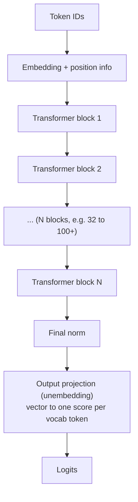
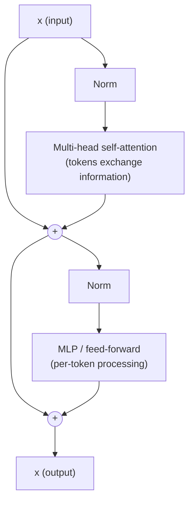
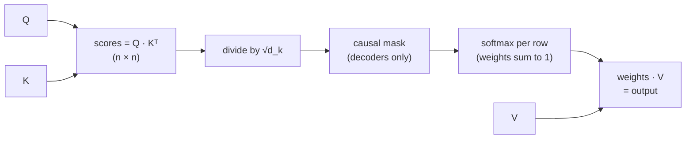
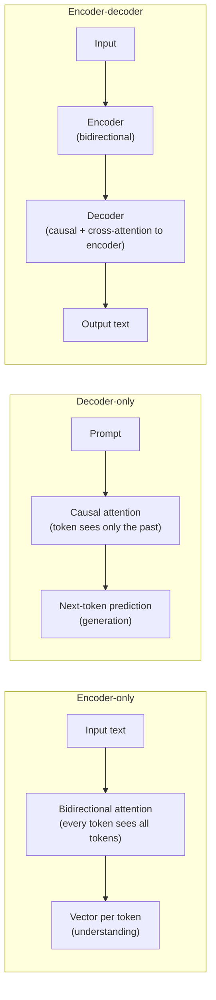

# 03 · The Transformer and the Model Taxonomy

## Key idea
A Transformer is a stack of identical blocks. In each block, **attention** lets every token gather information from other tokens, and an **MLP** processes each token's vector on its own. Stack dozens of blocks and the vectors turn from "what this token is" into "what should come next".

Depending on how the blocks are wired and masked, you get three families: **encoder-only**, **decoder-only** and **encoder-decoder**. Nearly all modern chat LLMs are decoder-only.

---

## Part 1: The architecture

### The big picture

Every block takes a `(sequence length × d_model)` matrix and returns one of the **same shape**. That is why blocks can be stacked as deep as you like.

### Inside one block (modern decoder, "pre-norm" style)


| Part | Job | Analogy |
|---|---|---|
| **Attention** | Mix information *between* tokens | A meeting where each token asks questions and listens to the relevant others |
| **MLP** | Transform each token's vector *independently* (expand to ~4x width, nonlinearity, shrink back). Much of the model's stored "knowledge" is believed to live here | Each token thinking on its own after the meeting |
| **Residual connection** (`+`) | Add the block's output to its input instead of replacing it | A shared notebook that each block annotates; also keeps training stable in deep stacks |
| **Normalization** (LayerNorm / RMSNorm) | Rescale vectors so numbers stay in a healthy range | Keeping volume levels sane between stages |

---

## Part 2: Attention in detail

### Intuition: queries, keys, values
Each token produces three vectors from its current vector (by multiplying with learned matrices):

- **Query (Q):** "what am I looking for?"
- **Key (K):** "what do I contain / advertise?"
- **Value (V):** "what information do I hand over if you pick me?"

A token compares its query to every key. The better the match, the more of that token's value it takes in. The result is a **weighted average of value vectors**.

Example: in *"The animal didn't cross the street because it was tired"*, the token `it` should attend strongly to `animal`. Attention is how the model can make that link, whatever the distance.

### The formula
```text
Attention(Q, K, V) = softmax( Q · Kᵀ / √d_k ) · V
```
Step by step:



1. **`Q · Kᵀ`**: dot product of every query with every key gives an `n × n` table of match scores.
2. **`/ √d_k`**: scale down by the square root of the key dimension. Why? A dot product of two `d_k`-dimensional vectors with unit-variance entries has variance about `d_k`, so scores grow with dimension. Large scores push softmax into a near one-hot regime where gradients almost vanish and training stalls. Dividing by `√d_k` keeps scores at a stable scale.
3. **Mask** (decoders): set scores for *future* positions to -∞ so token *i* can only see tokens ≤ *i*. This is what makes next-token training valid and generation possible (see Part 3).
4. **`softmax`**: turn each row of scores into weights that are positive and sum to 1.
5. **`· V`**: use the weights to average the value vectors.

### The causal mask
```text
        sees→  The  cat  sat  down
The            [ ✓    ✗    ✗    ✗ ]
cat            [ ✓    ✓    ✗    ✗ ]
sat            [ ✓    ✓    ✓    ✗ ]
down           [ ✓    ✓    ✓    ✓ ]
```
Row = the token that is "looking", column = the token it may look at.

### Multi-head attention
One attention pattern is limited, so the model runs several in parallel (**heads**), each with its own Q/K/V matrices working on a slice of the vector. Different heads tend to pick up different relations (nearby words, syntax links, copying earlier tokens, and so on). Head outputs are concatenated and mixed by an output matrix.

### Pseudo-code
```text
function attention(Q, K, V, mask):
    scores  = (Q @ K.T) / sqrt(d_k)
    scores  = apply_mask(scores)            # future positions -> -inf
    weights = softmax(scores, per row)
    return weights @ V

function multi_head(x):
    for each head h:
        Q, K, V = x @ Wq[h], x @ Wk[h], x @ Wv[h]
        out[h]  = attention(Q, K, V, causal_mask)
    return concat(out) @ Wo

function block(x):
    x = x + multi_head(norm(x))
    x = x + mlp(norm(x))
    return x
```

### Runnable example
[`examples/python/attention.py`](../examples/python/attention.py) implements the formulas above in NumPy: `softmax`, `scaled_dot_product_attention`, `multi_head_attention`, and a full `transformer_block`. Tests in `tests/` check that weights sum to 1 and, importantly, that **changing a future token never changes earlier outputs**.

```python
import numpy as np
from attention import scaled_dot_product_attention, causal_mask

x = np.random.default_rng(0).normal(size=(4, 16))      # 4 tokens, 16-dim
out, weights = scaled_dot_product_attention(x, x, x, causal_mask(4))
print(np.round(weights, 2))   # lower-triangular; each row sums to 1
```
With random, untrained vectors the weights concentrate on each token itself. In a trained model they carry real structure.

### Cost: why context length is expensive
The score table is `n × n`, so attention compute and memory grow **quadratically** with sequence length. Doubling the context roughly quadruples attention work. This is the reason long context is a major engineering topic (handouts 06 and 07).

---

## Part 3: Generation, the KV cache, and parameters

### The KV cache
When generating token by token, the keys and values of *earlier* tokens never change (thanks to the causal mask). So the server **caches** each layer's K and V for all previous tokens and, for each new token, computes Q/K/V only for that one token.

```text
without cache: step t recomputes K,V for all t tokens   -> wasteful
with cache:    step t computes K,V for 1 new token, reads the rest from memory
```
Consequences developers should know:
- Cached prompts are cheaper and faster, which is why providers offer **prompt caching** for stable prefixes.
- The cache grows with context length and consumes **GPU memory**, often the real limit on concurrent users.
- Variants such as **multi-query / grouped-query attention (MQA/GQA)** share K/V across heads to shrink the cache. Many recent open models use GQA.

### Where the parameters are
Per block, roughly `4·d²` in attention and `8·d²` in the MLP (with the common 4x expansion), so about `12·d²` per layer:

```text
params ≈ 12 · n_layers · d_model²   (+ embeddings)
GPT-3:  12 · 96 · 12288² ≈ 174 billion   (reported: 175B)   ✓
```
This back-of-envelope estimate is useful for judging model size and memory (at 16-bit precision, each parameter takes 2 bytes).

### Prefill vs decode
- **Prefill:** processing your whole prompt at once. Parallel and compute-bound, so fast per token.
- **Decode:** generating one token at a time. Sequential and memory-bandwidth-bound, so slower per token.

This is why "time to first token" and "tokens per second" are separate metrics.

---

## Part 4: Three families and a model taxonomy

The original 2017 Transformer had both an encoder and a decoder. Later models kept one half or the other.



| | Encoder-only | Decoder-only | Encoder-decoder |
|---|---|---|---|
| Attention | Bidirectional (sees left and right) | Causal (left only) | Encoder bidirectional; decoder causal + **cross-attention** to encoder |
| Pretraining objective | Masked language modeling (fill in blanks) | Next-token prediction | Span corruption or denoising, text-to-text |
| Strength | Understanding: classification, search, NER, embeddings | Open-ended generation, chat, code, in-context learning | Input→output transformation: translation, summarization, speech-to-text |
| Generates text? | Not naturally | Yes | Yes |
| Typical use today | Embeddings and rerankers, classifiers | Chat assistants, coding, agents | Translation, speech (Whisper), some seq2seq tasks |

### Why decoder-only dominates today
- **One simple objective:** next-token prediction on raw text needs no labels.
- **Scales well and is versatile:** everything becomes "continue this text", so one model handles many tasks via prompting.
- **In-context learning and instruction following** emerged most strongly at scale in this family.
- **Efficient serving:** the KV cache fits it naturally.

Encoder-only and encoder-decoder models remain valuable where they are cheaper or better for a narrow job.

### Popular models by type
*As of November 2026. Verify before citing: this list ages quickly.*

| Family | Models (examples) | Notes |
|---|---|---|
| **Encoder-only** | BERT, RoBERTa, ALBERT, DistilBERT, DeBERTa, ELECTRA, ModernBERT | Classification, NER, search. Vision Transformers (ViT) are also encoder-only. Many text-embedding models are encoders (e.g., sentence-transformer family), though newer ones are often fine-tuned from decoder LLMs |
| **Encoder-decoder** | Original Transformer, T5 / mT5 / Flan-T5, BART / mBART, UL2, MarianMT, **Whisper** (audio encoder, text decoder) | Translation, summarization, speech recognition |
| **Decoder-only (dense)** | GPT-1/2/3/4 line, LLaMA family, Mistral 7B, Gemma, Phi, Falcon, Qwen (dense sizes), BLOOM, OPT | The mainstream LLM family |
| **Decoder-only + Mixture of Experts** | Mixtral, DeepSeek-V3 / R1, Qwen MoE variants, Llama 4, Grok-1 | Only a few "experts" run per token, so more total parameters at lower compute (handout 07) |
| **Proprietary chat models** | GPT-4 and successors, Claude, Gemini | Vendors do not fully publish architecture details. They are widely understood to be decoder-only Transformers (Gemini 1.5 was described by Google as a sparse MoE). Treat the internal details as unconfirmed |
| **Beyond the standard Transformer** | Mamba (state-space model), Jamba (Transformer + Mamba + MoE hybrid), RWKV | Linear-time sequence mixing instead of (or alongside) attention (handout 07) |
| **Dual-encoder (multimodal)** | CLIP | Separate image and text encoders trained to align |

### Choosing a type (rule of thumb)
```text
Need to classify / embed / search text cheaply?       -> encoder-only
Need translate / summarize / transcribe, fixed I/O?   -> encoder-decoder (or a decoder LLM)
Need chat, code, reasoning, tools, flexible tasks?    -> decoder-only
```

---

## Pitfalls
- **"Attention = understanding."** Attention weights are a mechanism, not an explanation. Weights do not reliably show *why* the model answered as it did.
- **"Decoder-only can't understand, only generate."** Reading the prompt is "understanding"; large decoders match or beat encoders on many understanding tasks, just at higher cost.
- **Ignoring the quadratic cost** when stuffing huge prompts, and the KV-cache memory that comes with it.
- **Confusing the families:** BERT-style models are not chat models, and GPT-style models do not use bidirectional attention.
- **Treating proprietary model internals as known facts.**

## Summary
- Block = attention (mix across tokens) + MLP (process per token), wrapped with residuals and normalization. Stack N of them.
- `softmax(QKᵀ/√d_k)·V`: the scaling keeps softmax from saturating. The causal mask enforces "no peeking ahead".
- Attention cost is quadratic in context. The KV cache makes decoding fast but eats memory.
- Three families: encoder-only (understand), decoder-only (generate, dominant today), encoder-decoder (transform).

## Further reading
- Vaswani et al., *Attention Is All You Need* (2017)
- Jay Alammar, *The Illustrated Transformer*
- Karpathy, *Let's build GPT: from scratch, in code* (video) and `nanoGPT`
- Devlin et al., *BERT* (2018); Raffel et al., *T5* (2019); Radford et al., *GPT-2* (2019)
- Shazeer, *Fast Transformer Decoding: One Write-Head is All You Need* (MQA, 2019)
