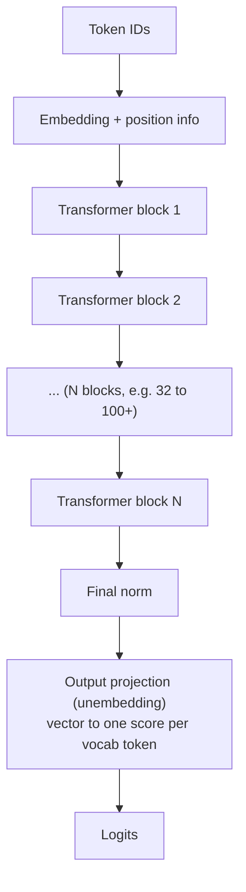
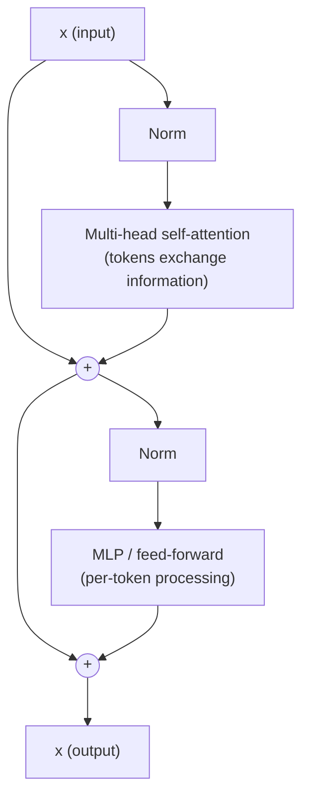
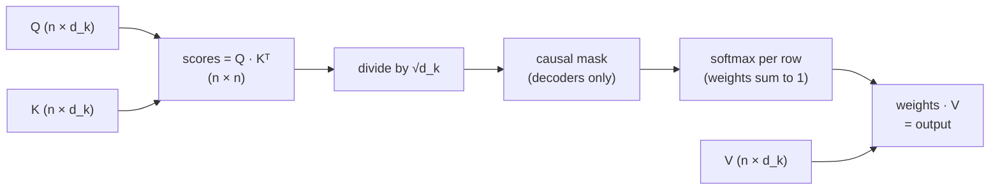
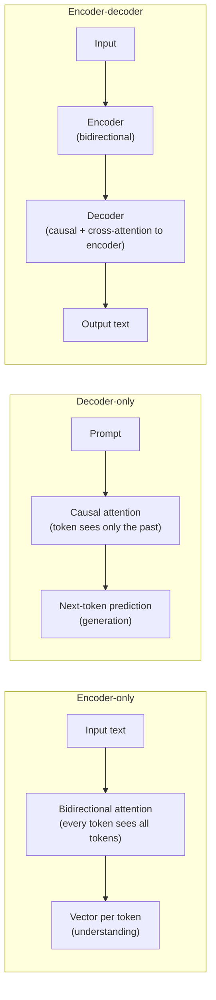

# 03 · The Transformer and the Model Taxonomy

## Key idea
A Transformer is a stack of identical blocks. In each block, **attention** lets every token gather information from other tokens, and an **MLP** (multi-layer perceptron, a feed-forward network) processes each token's vector on its own. Stack dozens of blocks and the vectors turn from "what this token is" into "what should come next".

Depending on how the blocks are wired and masked, you get three families: **encoder-only**, **decoder-only** and **encoder-decoder**. Nearly all modern chat LLMs are decoder-only.

---

## Part 1: The architecture

### The big picture

Every block takes an $n \times d_{\text{model}}$ matrix (one row per token) and returns one of the **same shape**. That is why blocks can be stacked as deep as you like.

> **Try it:** [LLM Visualization](https://bbycroft.net/llm) is an interactive 3D walkthrough of a GPT model, from embedding through attention and the MLP to softmax. It shows the same structure as the diagrams here, first on a tiny model and then at GPT-2 and GPT-3 scale. Its terms differ slightly: it says "feed forward" and "projection" where this handout says MLP and output projection, and it uses LayerNorm (as GPT-2 does) where many newer models use RMSNorm.

### Inside one block (modern decoder, "pre-norm" style)


| Part | Job | Analogy |
|---|---|---|
| **Attention** | Mix information *between* tokens | A meeting where each token asks questions and listens to the relevant others |
| **MLP** | Transform each token's vector *independently* (expand to about $4\times$ width, nonlinearity, shrink back). Much of the model's stored "knowledge" is believed to live here | Each token thinking on its own after the meeting |
| **Residual connection** (`+`) | Add the block's output to its input instead of replacing it | A shared notebook that each block annotates; also keeps training stable in deep stacks |
| **Normalization** (LayerNorm / RMSNorm, root-mean-square norm) | Rescale vectors so numbers stay in a healthy range | Keeping volume levels sane between stages |

---

## Part 2: Attention in detail

### Intuition: queries, keys, values
Each token produces three vectors from its current vector (by multiplying with learned matrices):

- **Query (Q):** "what am I looking for?"
- **Key (K):** "what do I contain / advertise?"
- **Value (V):** "what information do I hand over if you pick me?"

**What is trained and what is computed:** the three matrices $W_Q$, $W_K$, $W_V$ are learned weights. They are fixed after training and are the same for every token (each layer and head has its own set). The vectors **Q, K, V are not stored**. They are computed on the fly for the current text by multiplying each token's vector $x$ with those matrices:

$$
q_i = x_i W_Q, \qquad k_i = x_i W_K, \qquad v_i = x_i W_V \qquad \text{(for every token } i\text{)}
$$

Training teaches the matrices to produce queries and keys that match when tokens are relevant to each other.

**What "compares its query to every key" means:** take the token that is currently "looking", say `it`. Its query vector $q_{\text{it}}$ is compared (by dot product) with the key vector $k_j$ of **every token $j$ in the visible context**, including itself. That gives one score per token: a high score means "token $j$ is relevant to me". Softmax turns the scores into weights that sum to 1. The token then takes a **weighted average of the value vectors** $v_j$, so relevant tokens contribute more. This happens for every token at the same time (that is the $n \times n$ score table below: row = the looking token, column = the token it looks at).

Example: in *"The animal didn't cross the street because it was tired"*, the token `it` should attend strongly to `animal`. Attention is how the model can make that link, whatever the distance.

> **Visual explanation:** for a picture-by-picture walk-through of these steps, see Jay Alammar's [*The Illustrated Transformer*](https://jalammar.github.io/illustrated-transformer/). It explains the original encoder-decoder Transformer, while this handout focuses on the decoder-only variant used by most LLMs today.

### The formula

$$
\text{Attention}(Q, K, V) = \mathrm{softmax}\left(\frac{Q K^{\top}}{\sqrt{d_k}}\right) V
$$

**Notation** (from the original paper, now standard). $d$ stands for *dimension*, the length of a vector. The subscript says which vector, and $n$ and $h$ are counts:

| Symbol | Meaning | Example (original paper's base model) |
|---|---|---|
| $n$ | number of tokens in the sequence | varies |
| $d_{\text{model}}$ | length of the token vectors flowing through the whole model. This **is the embedding size** (also called *hidden size* or *model dimension*) | 512 |
| $h$ | number of attention heads | 8 |
| $d_k$ | length of the query and key vectors (must match, because $q \cdot k$ needs equal lengths) | 64 |
| $d_v$ | length of the value vectors (can differ from $d_k$, usually equal) | 64 |
| $d_{\text{ff}}$ | width of the MLP's hidden layer | 2048 |

With multi-head attention, $d_{\text{model}}$ is split across the heads:

$$
d_k = d_v = \frac{d_{\text{model}}}{h} \qquad \text{(here } 512 / 8 = 64\text{)}
$$

That is why the formula divides by $\sqrt{d_k}$, the square root of the **per-head** size, not of the full model width. In `attention.py` the same quantity is called `d_head`.

How the sizes relate to the embedding size: $d_{\text{model}}$ is the length of the vector produced by the embedding lookup (handout 02), and every block takes and returns vectors of that same length. $d_k$ and $d_v$ are derived from it ($d_{\text{model}} / h$). $d_{\text{ff}}$ is usually about $4 \times d_{\text{model}}$: the MLP expands the vector to $d_{\text{ff}}$ and shrinks it back to $d_{\text{model}}$. After the first block these vectors are no longer "just the token's embedding", since attention and MLP layers have enriched them, so they are better called **hidden states**. The size stays $d_{\text{model}}$.

**In plain words, the two sizes that matter most:**
- $d_{\text{model}}$ is **how much the model can say about one token**. It is the width of the vector that represents each token as it flows through the network (the hidden state). Facts, grammar, position cues and context-dependent meaning all have to fit into these numbers. It also drives model size, because the parameters grow roughly with its square ($12 \cdot n_{\text{layers}} \cdot d_{\text{model}}^{2}$, see "Where the parameters are").
- $d_k$ is the **"lens" of one head**. Each head projects a token's $d_{\text{model}}$ numbers into a smaller space of $d_k$ numbers, using $W_Q$ and $W_K$, and compares "what I am looking for" (query) with "what I offer" (key) in that space. Different heads learn different lenses, such as nearby words, syntax links or earlier mentions. $d_v$ is the matching width of what a head passes on once it has chosen.
- Neither says anything about how many tokens there are. They are the width **per token**, while $n$ is the **number of tokens**. They are also weight dimensions, so they stay fixed whatever the context length.

#### Real models compared
The same quantities for real models, in order of appearance (as of 22 November 2026). "not published" means the lab has not released that number.

| Model | $d_{\text{model}}$ | Heads | $d_k$ per head | Parameters | Date | Notes |
|---|---|---|---|---|---|---|
| Original Transformer (base) | 512 | 8 | 64 | 65M (big variant: 213M) | June 2017 | Encoder-decoder, 6+6 layers, $d_{\text{ff}} = 2048$ |
| GPT-1 | 768 | 12 | 64 | about 117M | June 2018 | Decoder-only, 12 layers, 512-token context |
| GPT-3 | 12288 | 96 | 128 | 175B | May to June 2020 | 96 layers, 2,048-token context, about 300B training tokens |
| ChatGPT | not published | not published | not published | not disclosed | 30 Nov 2022 | GPT-3.5 series with chat tuning (RLHF). Free public interface. |
| Llama 3 8B | 4096 | 32 (8 key/value heads) | 128 | about 8B | 18 Apr 2024 | 32 layers, grouped-query attention, open weights, 8K context at launch |
| Claude Fable 5.2 (Anthropic) | not published | not published | not published | not disclosed | 9 Nov 2026 | 1M-token context, 128K max output |
| Gemini 4 Carbon (Google) | not published | not published | not published | not disclosed | 10 Nov 2026 | Built on Gemini 4 Argon, which Google describes as a large-scale sparse MoE transformer with native multimodal input. 1M-token context. |
| GPT-6.2 Astra (OpenAI) | not published | not published | not published | not disclosed | 17 Nov 2026 | OpenAI's frontier model, released together with GPT-6.2 Sol |

What the table shows:
- The published designs ($d_{\text{model}}$ from 512 to 12288) all have $d_k$ of 64 or 128. Bigger models get more heads, not wider ones.
- Parameters grew by more than 2,000 times from the original Transformer to GPT-3, while the structure stayed the same.
- For ChatGPT and the three 2026 models, the labs do not publish layer sizes, heads or parameter counts, so those cells are empty instead of estimated.

The 2026 rows are the top models of each lab at the time of writing (the same labs also offer cheaper siblings, such as Claude Opus 5.5 and GPT-6.2 Sol), and they will age quickly. The Google date is the publication date of the model card, and the OpenAI date comes from press reports, since the announcement page shows no date in its text.

Sources: [Attention Is All You Need](https://arxiv.org/abs/1706.03762), [GPT-1 paper](https://cdn.openai.com/research-covers/language-unsupervised/language_understanding_paper.pdf), [GPT-3 paper](https://arxiv.org/abs/2005.14165), [ChatGPT announcement](https://openai.com/index/chatgpt/), [Llama 3 model card](https://github.com/meta-llama/llama3/blob/main/MODEL_CARD.md), [Claude models overview](https://platform.claude.com/docs/en/models/overview) and [Fable 5.2 launch coverage](https://9to5mac.com/2026/11/09/anthropic-upgrades-claude-with-new-fable-5-2-model-details-here/), [Gemini 4 Carbon](https://deepmind.google/models/model-cards/gemini-4-carbon/) and [Gemini 4 Argon](https://deepmind.google/models/model-cards/gemini-4-argon/) model cards, [OpenAI's GPT-6.2 announcement](https://openai.com/index/introducing-gpt-6-2-astra-sol/) and [press coverage of its release](https://emergent.sh/news/openai-launches-gpt-6-2-sol-multimodal-ai).

**Vectors or matrices?** Both views are the same thing. Each token has its own $q$, $k$ and $v$ **vector** (length $d_k$). In the formula and diagram, **$Q$, $K$, $V$ are matrices**: the vectors of all $n$ tokens stacked as rows, shape $n \times d_k$. Stacking lets one matrix multiplication compare every token with every other token at once. The learned weights $W_Q$, $W_K$, $W_V$ are also matrices ($d_{\text{model}} \times d_k$).

Step by step:



1. **Scores, $QK^{\top}$:** the dot product of every query with every key gives an $n \times n$ table of match scores.
2. **Scaling, $\div\sqrt{d_k}$:** scale down by the square root of the key dimension. Why? A dot product of two $d_k$-dimensional vectors with unit-variance entries has variance about $d_k$, so scores grow with dimension. Large scores push softmax into a near one-hot regime where gradients almost vanish and training stalls. Dividing by $\sqrt{d_k}$ keeps scores at a stable scale.
3. **Mask** (decoders): set scores for *future* positions to $-\infty$ so token $i$ can only see tokens at positions $\le i$. This is what makes next-token training valid and generation possible (see Part 3).
4. **Softmax:** turn each row of scores into weights that are positive and sum to 1.
5. **Weighted values, $\cdot V$:** use the weights to average the value vectors.

### Why "query", "key" and "value"? What if you swap them?
The names are an **analogy to a lookup** (ask a question, match it against labels, get the content). Nothing inside $W_Q$ or $W_K$ is intrinsically "query-like". A matrix gets its role only from **where its output is used in the formula**:

- $Q$ is the first factor of $QK^{\top}$: its rows are the **asking** side of the score table.
- $K$ is the second factor: its rows are what gets **matched against**, and softmax normalizes the weights over this side.
- $V$ is what is actually **averaged and returned**.

Training then shapes each matrix so that it does its job well. The roles are learned, not built in.

**What if you swap Q and K?** It depends on what exactly you swap:
- **Rename only, then train from scratch:** nothing changes. The matrices start random, so "the matrix in the first slot" simply learns to be the asking side. The names are labels.
- **Swap them in an already trained model** (use $W_K$ where $W_Q$ was): the score table becomes its **transpose**, and softmax now normalizes along the other direction. That is a different function, and the trained model breaks.

A way to see the mechanism: the score between token $i$ and token $j$ is

$$
\text{score}_{ij} = (x_i W_Q)(x_j W_K)^{\top} = x_i  \bigl(W_Q W_K^{\top}\bigr)  x_j^{\top}
$$

so the model really learns **one matrix $M = W_Q W_K^{\top}$** that says "how much does token $i$ care about token $j$". Swapping Q and K replaces $M$ by $M^{\top}$, which reverses the relation to "how much does $j$ care about $i$".

**Why two matrices, not one?** If $W_Q = W_K = W$, then $M = W W^{\top}$ is symmetric: $i$ would always care about $j$ exactly as much as $j$ cares about $i$. Language needs asymmetry: `it` looks for `animal`, but `animal` does not look for `it`. Two separate matrices allow an asymmetric $M$. Splitting it into two thin matrices ($d_{\text{model}} \times d_k$) is also cheaper than one full $d_{\text{model}} \times d_{\text{model}}$ matrix, and it lets each token's key be computed once and reused (see the KV cache below).

**Why a separate $V$?** What makes a token *findable* (its key) is not the same as what it *contributes* once found (its value).

### The causal mask
In a decoder, the "every token $j$ in the visible context" above is restricted by the mask: token $i$ may only compare its query with the keys of tokens at positions $j \le i$ (itself and earlier ones). The scores for later positions are blocked before softmax, so they get weight 0 and contribute nothing.
```text
        sees→  The  cat  sat  down
The            [ ✓    ✗    ✗    ✗ ]
cat            [ ✓    ✓    ✗    ✗ ]
sat            [ ✓    ✓    ✓    ✗ ]
down           [ ✓    ✓    ✓    ✓ ]
```
Row = the token that is "looking", column = the token it may look at.

### Multi-head attention
One attention pattern is limited, so the model runs several in parallel (**heads**), each with its own Q/K/V matrices working on a slice of the vector. Different heads tend to pick up different relations (nearby words, syntax links, copying earlier tokens, and so on). Head outputs are concatenated and mixed by an output matrix.

### Pseudo-code
```text
function attention(Q, K, V, mask):
    scores  = (Q @ K.T) / sqrt(d_k)
    scores  = apply_mask(scores)            # future positions -> -inf
    weights = softmax(scores, per row)
    return weights @ V

function multi_head(x):
    for each head h:
        Q, K, V = x @ Wq[h], x @ Wk[h], x @ Wv[h]
        out[h]  = attention(Q, K, V, causal_mask)
    return concat(out) @ Wo

function block(x):
    x = x + multi_head(norm(x))
    x = x + mlp(norm(x))
    return x
```

### Runnable example
[`examples/python/attention.py`](../examples/python/attention.py) implements the formulas above in NumPy: `softmax`, `scaled_dot_product_attention`, `multi_head_attention`, and a full `transformer_block`. Tests in `tests/` check that weights sum to 1 and, importantly, that **changing a future token never changes earlier outputs**.

```python
import numpy as np
from attention import scaled_dot_product_attention, causal_mask

x = np.random.default_rng(0).normal(size=(4, 16))      # 4 tokens, 16-dim
out, weights = scaled_dot_product_attention(x, x, x, causal_mask(4))
print(np.round(weights, 2))   # lower-triangular; each row sums to 1
```
With random, untrained vectors the weights concentrate on each token itself. In a trained model they carry real structure.

### Cost: why context length is expensive
The score table is $n \times n$, so attention compute and memory grow **quadratically**, $O(n^2)$, with sequence length. Doubling the context roughly quadruples attention work. This is the reason long context is a major engineering topic (handouts 06 and 07).

---

## Part 3: Generation, the KV (key-value) cache, and parameters

### The KV cache
When generating token by token, the keys and values of *earlier* tokens never change (thanks to the causal mask). So the server **caches** each layer's K and V for all previous tokens and, for each new token, computes Q/K/V only for that one token.

```text
without cache: step t recomputes K,V for all t tokens   -> wasteful
with cache:    step t computes K,V for 1 new token, reads the rest from memory
```
**But K and V are computed for every token. How can they be cached?** "Computed for every token" means each token's $k$ and $v$ are computed **once**, when that token is first processed, and then **reused** instead of recomputed. That is safe for two reasons:

1. $k_i = x_i W_K$ and $v_i = x_i W_V$ depend only on token $i$'s own vector $x_i$ (at that layer) and on fixed weights.
2. Thanks to the causal mask, $x_i$ at every layer depends only on tokens up to $i$, never on later ones. Layer 1 sees only tokens at positions $\le i$, so its outputs for position $i$ do too, and by induction so does every later layer. Appending new tokens therefore never changes $x_i$, $k_i$ or $v_i$.

**Q is not cached because it is never needed again.** $q_i$ is used only once, to compute token $i$'s own output. A later token $t$ uses **its own** query $q_t$ against the stored keys and values of earlier tokens.

So one decode step for a new token $t$ is: compute $q_t$, $k_t$, $v_t$; append $k_t$, $v_t$ to the cache; attend $q_t$ over all cached keys and values; discard $q_t$. Each layer (and each head) keeps its own cache. This works only for causal models. In a bidirectional encoder, earlier tokens' vectors do change when later tokens are added, so nothing could be reused. The cache is also valid only for an **identical prefix**, which is why prompt caching needs a stable start of the prompt (handout 06). [`examples/python/kv_cache.py`](../examples/python/kv_cache.py) shows identical outputs with 50 instead of 1,275 key/value projections.

Consequences developers should know:
- Cached prompts are cheaper and faster, which is why providers offer **prompt caching** for stable prefixes.
- The cache grows with context length and consumes **GPU memory**, often the real limit on concurrent users.
- Variants such as **multi-query / grouped-query attention (MQA/GQA)** share K/V across heads to shrink the cache. Many recent open models use GQA.

#### A second view: the cache step by step
The same mechanism again, this time following the matrices through a short generation. Suppose the prompt has 2 tokens:

| Step | Tokens processed | $Q$ rows computed | $Z$ rows produced | K and V cache afterwards |
|---|---|---|---|---|
| Prefill (the 2-token prompt) | 1 and 2, together | $q_1, q_2$ | $z_1, z_2$ | $k_1, k_2$ and $v_1, v_2$ |
| Decode, step 2 | 3 | $q_3$ | $z_3$ | $k_1, k_2, k_3$ and $v_1, v_2, v_3$ |
| Decode, step 3 | 4 | $q_4$ | $z_4$ | $k_1 \dots k_4$ and $v_1 \dots v_4$ |

The **last** row of $Z$ (after the final layer, followed by the output projection and softmax of handout 04) gives the probabilities for the next token. The rows $q_2$ and $z_2$ are not recomputed at step 2: their job was done during prefill, and their effect lives on in the cached K and V of the layers above.

**Three ways to generate.** What each step recomputes, for a sequence of $n$ tokens:

| Mode | Query rows computed per step | Remark |
|---|---|---|
| No cache, whole sequence | $q_1 \dots q_n$ (all of them) | Correct but wasteful. Only the last row of $Z$ is used. |
| No cache, window of $w$ tokens | the last $w$ queries | The window slides, so positions and the deeper layers' hidden states change. Results differ from full context. |
| **KV cache** | $q_n$ only | Same results as full context, and fast. |

A cached sliding window (handout 07) is different from the middle row: it keeps the original K and V in a ring buffer instead of recomputing a shifted window.

**Which rows depend on what.** In $Z = \mathrm{softmax}(QK^{\top}/\sqrt{d_k})V$, row $i$ of $Z$ is computed from row $i$ of $Q$ only, together with the keys and values (up to position $i$ in a decoder). A previous query $q_k$ with $k < i$ only produces the earlier row $z_k$. It matters for token $i$ only indirectly: $z_k$ goes through the MLP, becomes token $k$'s input to the next layer, and there produces that layer's $k$ and $v$, which token $i$ attends to. Those are exactly the cached values, so no earlier query needs to be computed again. This is checked in `tests/test_examples.py`: the last output row is identical when computed from the last query alone, and changing $q_3$ changes only output row 3.

**Where the cache lives, and when it is full.** In practice the cache is a buffer reserved in advance (or a set of blocks, see handout 06) together with a counter of how many rows are filled. Each step writes the new $k$ and $v$ into the next free slot, and attention reads only the filled rows. The empty slots are not zeros that get attended to, they are simply never read. When the buffer reaches the model's maximum context length, a full-attention model cannot continue: generation stops, or the application shortens the conversation and sends it again, which runs prefill from scratch for the new prompt. Putting stable text such as the system prompt first lets its cached part be reused. Models with sliding-window attention instead overwrite the oldest slot, like a ring buffer (handout 07).

### Where the parameters are
Per block, roughly $4d^2$ parameters in attention and $8d^2$ in the MLP (with the common $4\times$ expansion, $d = d_{\text{model}}$), so about $12d^2$ per layer:

$$
\text{params} \approx 12 \cdot n_{\text{layers}} \cdot d_{\text{model}}^{2} \quad (+\ \text{embeddings})
$$

For GPT-3 ($96$ layers, $d_{\text{model}} = 12288$):

$$
12 \cdot 96 \cdot 12288^{2} \approx 174 \text{ billion} \qquad (\text{reported: } 175\text{B})
$$

This back-of-envelope estimate is useful for judging model size and memory (at 16-bit precision, each parameter takes 2 bytes).

### Prefill vs decode
- **Prefill:** processing your whole prompt at once. Parallel and compute-bound, so fast per token.
- **Decode:** generating one token at a time. Sequential and memory-bandwidth-bound, so slower per token.

This is why "time to first token" and "tokens per second" are separate metrics.

---

## Part 4: Three families and a model taxonomy

The original 2017 Transformer had both an encoder and a decoder. Later models kept one half or the other.



| | Encoder-only | Decoder-only | Encoder-decoder |
|---|---|---|---|
| Attention | Bidirectional (sees left and right) | Causal (left only) | Encoder bidirectional; decoder causal + **cross-attention** to encoder |
| Pretraining objective | Masked language modeling (fill in blanks) | Next-token prediction | Span corruption or denoising, text-to-text |
| Strength | Understanding: classification, search, NER (named-entity recognition), embeddings | Open-ended generation, chat, code, in-context learning | Input→output transformation: translation, summarization, speech-to-text |
| Generates text? | Not naturally | Yes | Yes |
| Typical use today | Embeddings and rerankers, classifiers | Chat assistants, coding, agents | Translation, speech (Whisper), some seq2seq tasks |

### Why decoder-only dominates today
- **One simple objective:** next-token prediction on raw text needs no labels.
- **Scales well and is versatile:** everything becomes "continue this text", so one model handles many tasks via prompting.
- **In-context learning and instruction following** emerged most strongly at scale in this family.
- **Efficient serving:** the KV cache fits it naturally.

Encoder-only and encoder-decoder models remain valuable where they are cheaper or better for a narrow job.

### Popular models by type
*As of November 2026. Verify before citing: this list ages quickly.*

Name expansions: **GPT** = Generative Pre-trained Transformer, **BERT** = Bidirectional Encoder Representations from Transformers, **T5** = Text-to-Text Transfer Transformer, **ViT** = Vision Transformer, **CLIP** = Contrastive Language-Image Pre-training.

| Family | Models (examples) | Notes |
|---|---|---|
| **Encoder-only** | BERT, RoBERTa, ALBERT, DistilBERT, DeBERTa, ELECTRA, ModernBERT | Classification, NER, search. Vision Transformers (ViT) are also encoder-only. Many text-embedding models are encoders (e.g., sentence-transformer family), though newer ones are often fine-tuned from decoder LLMs |
| **Encoder-decoder** | Original Transformer, T5 / mT5 / Flan-T5, BART / mBART, UL2, MarianMT, **Whisper** (audio encoder, text decoder) | Translation, summarization, speech recognition |
| **Decoder-only (dense)** | GPT-1/2/3/4 line, LLaMA family, Mistral 7B, Gemma, Phi, Falcon, Qwen (dense sizes), BLOOM, OPT | The mainstream LLM family |
| **Decoder-only + Mixture of Experts** | Mixtral, DeepSeek-V3 / R1, Qwen MoE variants, Llama 4, Grok-1 | Only a few "experts" run per token, so more total parameters at lower compute (handout 07) |
| **Proprietary chat models** | GPT-4 and successors, Claude, Gemini | Vendors do not fully publish architecture details. They are widely understood to be decoder-only Transformers (Gemini 1.5 was described by Google as a sparse MoE). Treat the internal details as unconfirmed |
| **Beyond the standard Transformer** | Mamba (state-space model), Jamba (Transformer + Mamba + MoE hybrid), RWKV | Linear-time sequence mixing instead of (or alongside) attention (handout 07) |
| **Dual-encoder (multimodal)** | CLIP | Separate image and text encoders trained to align |

### Choosing a type (rule of thumb)
```text
Need to classify / embed / search text cheaply?       -> encoder-only
Need translate / summarize / transcribe, fixed I/O?   -> encoder-decoder (or a decoder LLM)
Need chat, code, reasoning, tools, flexible tasks?    -> decoder-only
```

---

## Pitfalls
- **"Attention = understanding."** Attention weights are a mechanism, not an explanation. Weights do not reliably show *why* the model answered as it did.
- **"Decoder-only can't understand, only generate."** Reading the prompt is "understanding"; large decoders match or beat encoders on many understanding tasks, just at higher cost.
- **Ignoring the quadratic cost** when stuffing huge prompts, and the KV-cache memory that comes with it.
- **Confusing the families:** BERT-style models are not chat models, and GPT-style models do not use bidirectional attention.
- **Treating proprietary model internals as known facts.**

## Summary
- Block = attention (mix across tokens) + MLP (process per token), wrapped with residuals and normalization. Stack N of them.
- $\mathrm{softmax}\left(QK^{\top}/\sqrt{d_k}\right)V$: the scaling keeps softmax from saturating. The causal mask enforces "no peeking ahead".
- Attention cost is quadratic in context. The KV cache makes decoding fast but eats memory.
- Three families: encoder-only (understand), decoder-only (generate, dominant today), encoder-decoder (transform).

## Further reading
- Vaswani et al., [*Attention Is All You Need*](https://arxiv.org/abs/1706.03762) (2017)
- Jay Alammar, [*The Illustrated Transformer*](https://jalammar.github.io/illustrated-transformer/)
- [*LLM Visualization*](https://bbycroft.net/llm): interactive 3D walkthrough of a GPT model (best on a desktop browser)
- Karpathy, [*Let's build GPT: from scratch, in code*](https://www.youtube.com/watch?v=kCc8FmEb1nY) (video) and the [`nanoGPT`](https://github.com/karpathy/nanoGPT) repo
- Devlin et al., [*BERT*](https://arxiv.org/abs/1810.04805) (2018); Raffel et al., [*T5*](https://arxiv.org/abs/1910.10683) (2019); Radford et al., [*Language Models are Unsupervised Multitask Learners*](https://cdn.openai.com/better-language-models/language_models_are_unsupervised_multitask_learners.pdf) (GPT-2, 2019)
- Shazeer, [*Fast Transformer Decoding: One Write-Head is All You Need*](https://arxiv.org/abs/1911.02150) (MQA, 2019)
