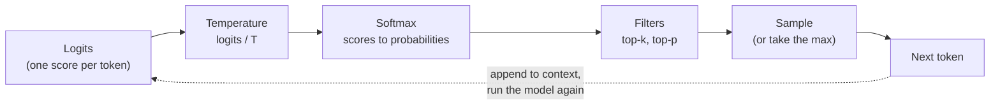
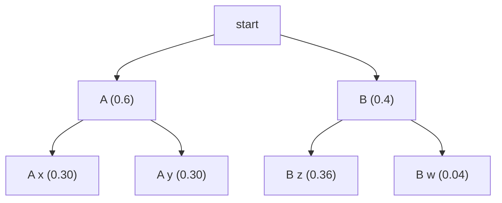

# 04 · Generation: From Logits to Text

## Key idea
The Transformer does not output a word. It outputs **logits**: one raw score for every token in the vocabulary. A separate step, **decoding**, turns those scores into a probability distribution and picks one token. That pick is appended to the input and the whole process repeats (**autoregressive generation**).

Randomness, "creativity", repetition and determinism are all controlled in this decoding step, not inside the network.



---

## Part 1: Logits and softmax

### Intuition
Logits are unnormalized "votes": they can be negative, and they don't sum to anything meaningful. **Softmax** converts them into probabilities (all positive, sum to 1) while keeping the order: a higher logit always means a higher probability.

$$
\operatorname{softmax}(z)_i = \frac{e^{z_i}}{\sum_{j} e^{z_j}}
$$

where $z_i$ is the logit of token $i$. Because of the exponential, differences between logits are amplified: a gap of $1$ means the top token is about $e^{1} \approx 2.7$ times more likely, a gap of $3$ about $e^{3} \approx 20$ times.

Example with a toy 4-token vocabulary:

| Token | `mat` | `sofa` | `moon` | `banana` |
|---|---|---|---|---|
| Logit | 3.0 | 2.0 | 0.5 | -1.0 |
| Probability | 0.68 | 0.25 | 0.06 | 0.01 |

A real vocabulary has 30k to 250k+ entries, so the probability mass is spread over a long tail of unlikely tokens. Much of the work in decoding is about handling that tail.

---

## Part 2: Decoding strategies

### Greedy decoding
Always take the highest-probability token (`argmax`).
- **Pro:** simple, repeatable.
- **Con:** can get stuck in repetitive loops and bland text. The locally best token is not always on the best overall path.

### Beam search
Keep the best $k$ partial sequences (**beams**) at each step, scored by total log-probability, and extend each. At the end, return the best sequence.


Greedy takes `A` first (0.6 > 0.4) and ends at probability 0.30. Beam search with width 2 keeps `B` alive too and finds `B z` at 0.36, the better full sequence. Runnable in [`examples/python/sampling.py`](../examples/python/sampling.py).

- **Pro:** finds higher-probability sequences. Good for tasks with a "right" output, such as translation and summarization.
- **Con:** costs $k$ times more, and tends to produce generic, repetitive text for open-ended generation. Chat assistants typically use sampling instead.

### Sampling
Draw the next token randomly **according to the probabilities**: a token with 68% is picked 68% of the time. This gives varied, more natural text, and it is the default for chat models. It also means the same prompt can produce different answers.

---

## Part 3: Controlling sampling

### Temperature
Divide the logits by the temperature $T$ before softmax:

$$
p_i = \frac{e^{z_i / T}}{\sum_{j} e^{z_j / T}}
$$

| Setting | Effect | Example (probabilities of the 4 tokens above) |
|---|---|---|
| $T \to 0$ | Sharper, approaches greedy | $T = 0.2$: 0.993 / 0.007 / 0.000 / 0.000 |
| $T = 1$ | Model's own distribution | 0.681 / 0.251 / 0.056 / 0.012 |
| $T > 1$ | Flatter, more random, more chance of odd tokens | $T = 2$: 0.493 / 0.299 / 0.141 / 0.067 |

$T = 0$ itself would divide by zero, so implementations treat it as "use argmax".

### Top-k
Keep only the $k$ most probable tokens, renormalize, and sample from those. Simple, but $k$ is fixed: sometimes the model is certain (1 good token) and sometimes it is unsure (hundreds of reasonable ones).

### Top-p (nucleus sampling)
Keep the **smallest set of top tokens whose probabilities add up to at least $p$** (for example $0.9$), then renormalize. The set size adapts: tiny when the model is confident, large when it is not.

```text
function top_p(probs, p):
    sort tokens by probability, descending
    keep tokens until cumulative probability >= p
    zero out the rest, renormalize
```
Related: **min-p** keeps tokens whose probability is at least a fraction of the top token's probability. It is available in several open-source inference engines.

### Putting it together
```text
function sample_next(logits, T, top_k, top_p):
    if T == 0: return argmax(logits)
    probs = softmax(logits / T)
    if top_k: probs = keep_top_k(probs, top_k)
    if top_p: probs = keep_top_p(probs, top_p)
    return random_choice(tokens, weights = probs)
```
The order (temperature, then top-k, then top-p) is common but implementations differ in details. Check the library you use.

```python
import numpy as np
from sampling import next_token_distribution, sample

logits = np.array([3.0, 2.0, 0.5, -1.0])
print(next_token_distribution(logits, temperature=0.2))    # near one-hot
print(next_token_distribution(logits, top_p=0.9))           # [0.73 0.27 0. 0.]
token_id = sample(logits, temperature=0.8, top_p=0.95)
```

### Other controls you will meet in APIs
| Control | What it does |
|---|---|
| `max_tokens` | Hard cap on generated length. The reply is cut off, possibly mid-sentence |
| Stop sequences | Stop when a given string appears (and typically exclude it) |
| End-of-sequence token | The model itself emits a special token meaning "I'm done" |
| Repetition / frequency / presence penalties | Lower the logits of tokens that already appeared, to discourage loops |
| Logit bias | Manually raise or lower specific tokens (ban a word, force a choice) |
| Seed | Request reproducible sampling (best effort, see below) |
| Logprobs | Return the probabilities of chosen (and top alternative) tokens |

Parameter names, ranges and availability vary by provider and model, and some models (notably some reasoning models) restrict or ignore sampling parameters. Check the current API docs.

---

## Part 4: Structured output (constrained decoding)

Asking nicely ("reply in JSON") works most of the time, but not always. **Constrained decoding** guarantees valid structure by editing the logits at each step: tokens that would break the grammar or schema get their score set to $-\infty$, so they can never be sampled.

```text
function constrained_step(logits, grammar_state):
    allowed = grammar_state.valid_next_tokens()   # e.g. after '{"name":' only a string start is legal
    for token not in allowed:
        logits[token] = -infinity
    token = sample(logits)
    grammar_state.advance(token)
    return token
```
This is what "JSON mode", "structured outputs" or "grammar-based sampling" features do under the hood (in hosted APIs and in open-source engines). Two things to remember:
- It guarantees **form** (valid JSON matching a schema), not **truth**. Field values can still be wrong.
- Fields forced too early can hurt quality. If the model should reason first, give it a place to do so (for example a free-text "reasoning" field before the answer).

---

## Part 5: Consequences for developers

### Autoregressive means errors compound
Each token is conditioned on the previous ones, including the model's own earlier mistakes. There is no built-in "backspace". An early wrong claim becomes context that later tokens stay consistent with. This is one reason why "think step by step" and reasoning models can help: they produce intermediate text that the final answer then builds on.

### Determinism is weaker than you think
$T = 0$ or a fixed seed *reduces* variation, but identical outputs are not guaranteed. Floating-point math on GPUs can give tiny differences depending on batching and hardware, and a near-tie between two tokens can then flip. Design tests and pipelines to tolerate variation (see handout 09).

### Logprobs are useful signals
Token probabilities can serve as a rough confidence signal, for instance in classification (compare the probabilities of the label tokens), or to flag low-confidence spans. They are not calibrated truth probabilities.

### Starting points (not rules)
| Task | Typical settings |
|---|---|
| Extraction, classification, code, JSON | Low temperature (0 to 0.3), constrained output if available |
| General chat and Q&A | Provider default (often around 0.7 to 1.0) |
| Brainstorming, creative writing | Higher temperature and/or top-p around 0.9 to 0.95 |

Adjust **one** of temperature or top-p at a time. Their effects overlap, and changing both makes behavior hard to reason about.

---

## Pitfalls
- **"Temperature 0 means correct and deterministic."** It means "most likely token each step". The most likely continuation can still be wrong, and small numeric differences can still change results.
- **"Higher temperature = smarter or more creative."** It just flattens the distribution. Beyond a point you get incoherence.
- **Prompt-only JSON.** Parsing failures will happen in production. Use constrained or structured output features, plus validation and retry.
- **Cut-off outputs.** Always check the finish reason (`length` vs `stop`) before trusting an answer.
- **Tuning sampling to fix hallucinations.** Decoding settings change variety, not knowledge. Fix facts with better context (retrieval-augmented generation, RAG; handout 08) and verification.

## Summary
- The network outputs logits. Decoding turns them into the next token, and the loop repeats.
- Softmax makes probabilities. Temperature reshapes them. Top-k and top-p cut off the unlikely tail.
- Greedy and beam search favor the most probable sequence. Sampling gives variety.
- Constrained decoding enforces structure by masking illegal tokens.
- Outputs are only approximately reproducible, and errors compound because generation is autoregressive.

## Further reading
- Holtzman et al., [*The Curious Case of Neural Text Degeneration*](https://arxiv.org/abs/1904.09751) (top-p / nucleus sampling, 2019)
- Hugging Face blog, [*How to generate text: using different decoding methods*](https://huggingface.co/blog/how-to-generate)
- Docs on sampling parameters and structured outputs: [Anthropic](https://platform.claude.com/docs/en/home), [OpenAI](https://developers.openai.com/api/docs), or for self-hosting [vLLM](https://docs.vllm.ai/en/latest/)
