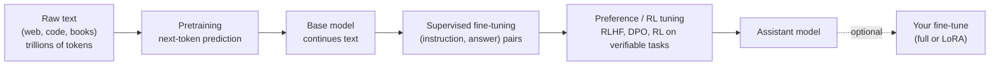
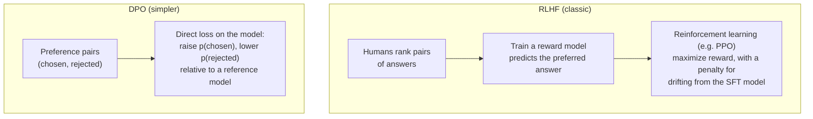
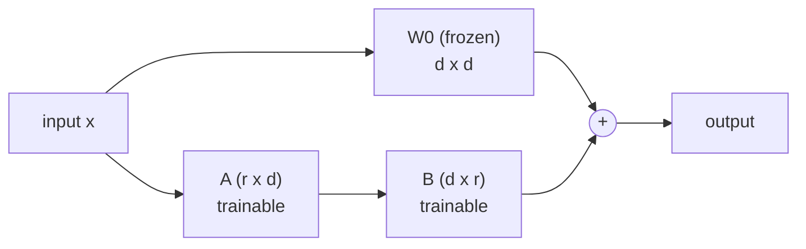

# 05 · Training: How an LLM Gets Its Abilities

## Key idea
Training a large language model (LLM) means adjusting billions of weights so that the model assigns high probability to the real next token. It happens in stages:

1. **Pretraining:** learn language, facts and patterns by predicting the next token on a huge text corpus. Result: a **base model**.
2. **Post-training:** teach the base model to behave like an assistant (**instruction tuning**, then **preference tuning** such as RLHF (reinforcement learning from human feedback) or DPO (direct preference optimization), and for reasoning models, reinforcement learning on checkable tasks).
3. **Optional adaptation by you:** fine-tune (often with LoRA, low-rank adaptation) for a narrow job.



Almost all of the cost (compute, data, money) is in stage 1.

---

## Part 1: Pretraining

### The objective: cross-entropy on the next token
For every position in a training text, the model predicts a distribution over the next token. The **loss** for one position is $-\log p(\text{correct token})$: small when the model gave the real token high probability, large when it did not. Training pushes the average over all $N$ positions down:

$$
\text{loss} = -\frac{1}{N} \sum_{t=1}^{N} \log p_{\text{model}}\left(\text{token}_{t+1} \mid \text{token}_1, \dots, \text{token}_t\right)
$$

**Perplexity** is $e^{\text{loss}}$: roughly "how many tokens the model is torn between on average". Lower is better. A model guessing uniformly over a vocabulary of $V$ tokens has perplexity $V$.

Because of the causal mask (handout 03), **one forward pass over a text produces a prediction, and so a loss, at every position at once**. This is called *teacher forcing*: the model always sees the true previous tokens, not its own guesses. It makes training massively parallel and efficient. No human labels are needed: the text is its own supervision (**self-supervised learning**).

### The training loop
```text
repeat for many steps:
    batch   = sample sequences of tokens from the corpus
    logits  = model(batch.inputs)                 # forward pass
    loss    = cross_entropy(logits, batch.targets)  # targets = inputs shifted by one
    grads   = backpropagate(loss)                 # how should each weight change?
    weights = optimizer_step(weights, grads)      # AdamW, with a learning-rate schedule
```
The same loop works for a table of 49 numbers or a model with hundreds of billions of weights. Runnable miniature in [`examples/python/train_bigram.py`](../examples/python/train_bigram.py): a bigram "model" whose logits are a table, trained with exactly this loop and cross-entropy gradient, which is $\mathrm{softmax}(z) - \text{onehot}(y)$.

```text
loss: start 1.946 -> end 0.579  (perplexity 7.0 -> 1.78)     # 1.946 = ln(7): uniform over 7 words
after 'the': {'cat': 0.5, 'fish': 0.25, 'mat': 0.25}          # learned the training-data frequencies
```
The model has discovered that after "the" comes "cat" half the time, purely by lowering the loss. An LLM does the same with a far richer notion of context.

### Practical ingredients
| Ingredient | What / why |
|---|---|
| **Optimizer: AdamW** | Per-weight adaptive step sizes with momentum, plus weight decay. The standard choice |
| **Learning-rate schedule** | Warm up from near zero, then decay (often cosine) toward a small value. Too high a rate makes training diverge, too low wastes compute |
| **Mixed precision** | Compute in 16-bit (bf16, bfloat16) for speed and memory, keep some state in 32-bit for stability |
| **Gradient clipping** | Cap huge gradients to avoid loss spikes |
| **Batch size** | Millions of tokens per step, built from many sequences |
| **Checkpoints** | Save regularly: runs last weeks and hardware fails |

### The data
The model is only as good as its data. Typical sources: filtered web crawls, code repositories, books, encyclopedias, scientific papers, and increasingly **synthetic data** generated by other models.

Real pipelines spend huge effort on:
- **Deduplication:** repeated text is memorized and wastes compute.
- **Quality filtering:** classifiers and heuristics to drop spam and boilerplate.
- **Safety and privacy filtering:** remove toxic content and personal data (imperfectly).
- **Mixture:** the proportions of code, math, languages and so on strongly shape the model's strengths.

Consequences you will notice: the **knowledge cutoff** (the model knows nothing after its data ends), weaker performance in languages or domains with little data, and **memorization** of frequently repeated text.

### The scale
Training compute, measured in FLOPs (floating-point operations), follows a simple rule of thumb:

$$
\text{FLOPs} \approx 6 \cdot N \cdot D
$$

where $N$ = parameters and $D$ = training tokens (about 2 FLOPs for the forward pass and 4 for the backward pass, per parameter per token). For GPT-3 ($N = 175 \times 10^{9}$, $D \approx 300 \times 10^{9}$):

$$
6 \cdot (175 \times 10^{9}) \cdot (300 \times 10^{9}) \approx 3.2 \times 10^{23} \ \text{FLOPs} \qquad (\text{reported} \approx 3.1 \times 10^{23})
$$

Memory is the other constraint. Training holds weights, gradients **and optimizer state**, roughly **16 bytes per parameter** with Adam in mixed precision (versus 2 bytes per parameter to merely run a 16-bit model). A 70B model therefore needs on the order of a terabyte of accelerator memory just to train, which forces splitting the model and data over many GPUs:

| Parallelism | Splits... |
|---|---|
| Data parallel | the batch; every GPU holds a model copy (or shards of its state: ZeRO, Zero Redundancy Optimizer, or FSDP, Fully Sharded Data Parallel) |
| Tensor parallel | individual weight matrices across GPUs |
| Pipeline parallel | groups of layers across GPUs |
| Expert parallel | MoE (mixture of experts) experts across GPUs (handout 07) |

You do not need to implement this, but it explains why only a few organizations pretrain frontier models.

### Scaling laws
Loss falls as a smooth power law as you increase parameters, data and compute (Kaplan et al., 2020). **Chinchilla** (Hoffmann et al., 2022) showed that for a fixed compute budget, parameters and tokens should be scaled together, roughly **20 training tokens per parameter** (70B parameters on 1.4T tokens beat much larger, under-trained models).

Since then, many teams deliberately **over-train** smaller models far beyond that ratio (for example, tens of trillions of tokens for models of 8B parameters, i.e. over a thousand tokens per parameter). The reason is that training is paid once but inference is paid on every request, so a smaller model that is expensive to train but cheap to serve wins in production.

Related, still debated: **emergent abilities**, where a skill seems to appear suddenly at some scale. Some of the apparent sharpness depends on how it is measured. Treat "it will emerge at the next size" as a hypothesis, not a guarantee.

---

## Part 2: Post-training: from text predictor to assistant

A base model asked "What is the capital of France?" may continue with more quiz questions, because that is a plausible continuation. Post-training changes that.

### 1. Supervised fine-tuning (SFT)
Train further, with the same next-token loss, on curated **(prompt, ideal response)** examples, formatted with the chat template. Typically tens of thousands to millions of examples, far less data than pretraining. The model learns the format and style of an assistant: answer the question, follow the instruction.

### 2. Preference tuning
Examples of "good" are limited, but people can easily say which of two answers is **better**. That signal teaches nuance such as helpfulness, tone and refusing harmful requests.


- **RLHF:** train a reward model on human comparisons, then optimize the LLM against it with reinforcement learning (typically the PPO algorithm, proximal policy optimization). The penalty for drifting from the original model keeps outputs fluent and stops the model from exploiting quirks of the reward model ("reward hacking").
- **DPO** (Direct Preference Optimization): reach a similar goal with a simple supervised-style loss on preference pairs, no separate reward model or reinforcement-learning loop. Popular for its simplicity.
- **AI feedback (RLAIF, reinforcement learning from AI feedback; Constitutional AI):** a model, guided by written principles, produces some of the preference labels, to reduce the amount of human labeling.

### 3. Reinforcement learning on verifiable tasks
For math, code and puzzles the answer can be **checked automatically** (does the final answer match? do the unit tests pass?). Reinforcement learning with such verifiable rewards (RLVR) lets a model practice at scale. This is the main technique behind **reasoning models** (handout 01): they learn to produce long chains of intermediate reasoning because those chains lead to correct, checkable answers. Examples of published recipes include DeepSeek-R1's.

### What post-training does and does not do
- It strongly shapes **behavior**: format, tone, instruction following, refusals, willingness to say "I don't know".
- It adds **little new knowledge**. Most facts and skills come from pretraining.
- It can introduce quirks, such as sycophancy (agreeing with the user) and verbosity, because human raters tend to prefer them.

---

## Part 3: Fine-tuning for your own use

### Full fine-tuning vs LoRA
Updating every weight of a large model needs the full training memory (about 16 bytes per parameter) and produces a full-size copy per task. **LoRA** (Low-Rank Adaptation, Hu et al., 2021) freezes the original weights and learns a small *low-rank correction* to selected matrices:

$$
W_{\text{effective}} = W_0 + \frac{\alpha}{r}  B A
$$

where $W_0 \in \mathbb{R}^{d_{\text{out}} \times d_{\text{in}}}$ is frozen, $B \in \mathbb{R}^{d_{\text{out}} \times r}$ and $A \in \mathbb{R}^{r \times d_{\text{in}}}$ are trained, $\alpha$ is a scaling constant, and the rank $r \ll d$ (for example $r = 8$).


- $B$ starts at zero, so the model begins exactly as the base model.
- For a $4096 \times 4096$ matrix, $r = 8$ trains 65,536 values instead of 16.8M (**0.39%**).
- After training, $BA$ can be **merged** into $W_0$, so there is no extra latency at serving time. Or you can keep adapters separate and swap them per task or per customer.
- **QLoRA** (quantized LoRA) additionally stores the frozen base weights in 4-bit precision, so large models can be tuned on a single GPU.

Runnable in [`examples/python/lora.py`](../examples/python/lora.py); tests check the identical-at-start and exact-merge properties.

### Should you fine-tune at all?
| Need | Try first |
|---|---|
| The model lacks specific, changing or private **knowledge** | Put it in the prompt: retrieval / RAG, retrieval-augmented generation (handout 08) |
| The model misunderstands the task or format | Better prompts, examples in the prompt, structured output |
| You need consistent **style, tone or format** at scale, or a narrow task done cheaply with a small model | **Fine-tuning** |
| You want to distill a big model's behavior into a small one | Fine-tuning on the big model's outputs |

Fine-tuning is poor at *injecting facts* (the model may learn the style of the facts but still hallucinate details) and can cause **catastrophic forgetting** of general abilities if overdone. Quality of a small dataset matters far more than quantity.

---

## Part 4: Evaluation

How do we know a model is good? No single number works.

| Method | What it measures | Weakness |
|---|---|---|
| **Perplexity / loss** | How well it predicts held-out text | Says little about usefulness of answers; not comparable across tokenizers |
| **Benchmarks** (MMLU, GSM8K, HumanEval, SWE-bench, ...) | Knowledge, math, coding, and so on, with automatic scoring | **Saturation** (top models score near the ceiling) and **contamination** (test questions leaking into training data) |
| **Human preference** (arena-style pairwise votes, ranked with Elo-like scores) | Which answers people like | Favors style and length, noisy |
| **LLM-as-judge** | Cheap grading of open-ended answers by another model | Biases: prefers longer answers, its own style, first position |
| **Your own task evals** | Performance on *your* inputs | You must build and maintain them |

The practical lesson for developers: **public leaderboards help you shortlist, but only your own evaluation set tells you what works for your product.** Handout 09 covers building one.

---

## Pitfalls
- **"The model learned from my conversations."** Not in the weights. Training is a separate offline process (handout 00).
- **"Fine-tune to teach it our docs."** Usually the wrong tool. Use retrieval for knowledge, and fine-tuning for behavior.
- **"More parameters always win."** Data quality, token count and post-training matter as much (handout 01, Chinchilla).
- **Trusting benchmark numbers blindly.** Contamination and overfitting to benchmarks are real.
- **Training on model outputs without care.** Repeatedly training on synthetic data can reduce diversity and amplify errors.

## Summary
- Pretraining = next-token cross-entropy over trillions of tokens, one forward pass gives a loss at every position. $\text{FLOPs} \approx 6 N D$.
- Post-training (SFT, RLHF/DPO, reinforcement learning on verifiable tasks) shapes behavior, not much new knowledge.
- LoRA trains tiny low-rank adapters on a frozen model: cheap, mergeable, swappable.
- Fine-tune for style and format, retrieve for knowledge.
- Evaluate on your own tasks, and treat public benchmarks with care.

## Further reading
- Kaplan et al., [*Scaling Laws for Neural Language Models*](https://arxiv.org/abs/2001.08361) (2020); Hoffmann et al., [*Chinchilla*](https://arxiv.org/abs/2203.15556) (2022)
- Ouyang et al., [*Training language models to follow instructions with human feedback*](https://arxiv.org/abs/2203.02155) (2022)
- Rafailov et al., [*Direct Preference Optimization*](https://arxiv.org/abs/2305.18290) (2023)
- Hu et al., [*LoRA*](https://arxiv.org/abs/2106.09685) (2021); Dettmers et al., [*QLoRA*](https://arxiv.org/abs/2305.14314) (2023)
- Karpathy, [*State of GPT*](https://www.youtube.com/watch?v=bZQun8Y4L2A) (talk, Microsoft Build 2023) and [*Let's reproduce GPT-2 (124M)*](https://www.youtube.com/watch?v=l8pRSuU81PU) (video)
