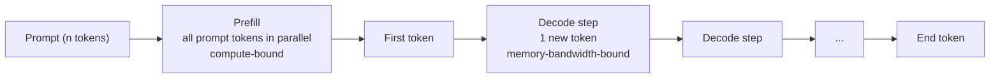
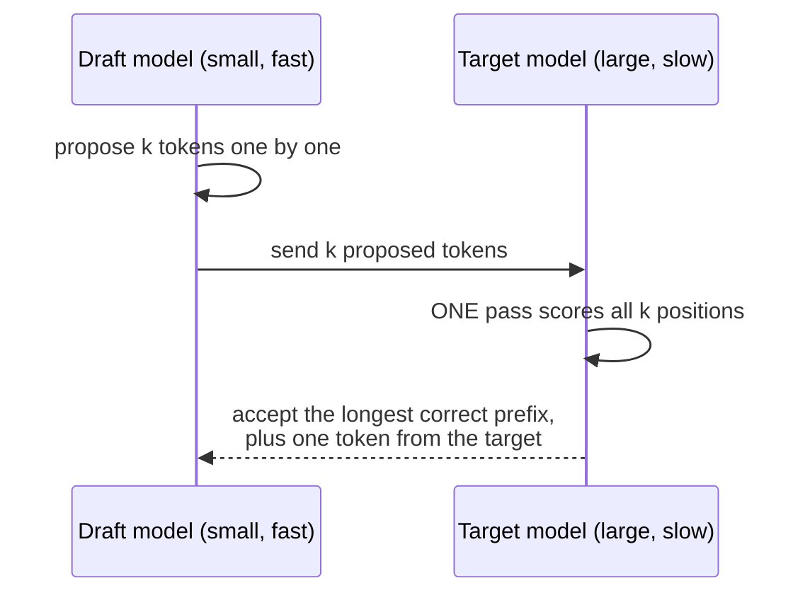

# 06 · Inference and Serving: Latency, Memory and Cost

## Key idea
Running a model is a **memory problem as much as a compute problem**. Generating each token requires streaming (nearly) all of the model's weights and the whole KV cache through the GPU. Almost every serving technique, such as batching, quantization, caching and speculative decoding, is a way to move less memory, share it among more requests, or use each pass over it more productively.

---

## Part 1: Where the time goes

Recall from handout 03 that serving has two phases:



- **Prefill** processes the whole prompt at once. Matrix multiplications are large, so the GPU's arithmetic units are the bottleneck (**compute-bound**).
- **Decode** produces one token per step. Each step does little arithmetic but must read all the weights and the KV cache from GPU memory, so memory bandwidth is the bottleneck (**memory-bandwidth-bound**).

### A back-of-envelope speed limit
At batch size 1, each generated token reads every weight once:

$$
\text{max tokens/s} \approx \frac{\text{memory bandwidth}}{\text{model size in bytes}}
$$

For an 8B model at 16-bit ($\approx 16$ GB) on a GPU with $1$ TB/s, that is at most $\approx 60$ tokens/s. (Illustrative numbers. Real systems get below this bound.) Two consequences:
- A **smaller model** (fewer bytes) or **fewer bits per weight** (quantization) is directly faster.
- Serving **many requests at once** (batching) reads the weights *once* for all of them, so total throughput rises enormously while each user's speed barely drops.

### The metrics
| Metric | Meaning | Matters for |
|---|---|---|
| **TTFT** (time to first token) | Request sent until the first token arrives; mostly prefill plus queueing | Interactive feel |
| **TPOT** (time per output token) / inter-token latency | Gap between consecutive tokens | Streaming smoothness, total time for long answers |
| **Throughput** | Total tokens per second across all users | Cost per token, capacity |
| **Cost per token** | Hardware cost divided by throughput | Your bill |

Latency and throughput trade off: larger batches raise throughput but make each request slightly slower. A good server picks a point on that curve.

---

## Part 2: Memory budget

$$
\text{GPU memory} = \text{model weights} + \text{KV cache (all active requests)} + \text{activations and overhead}
$$

### Weights

$$
\text{bytes} = \text{parameters} \times \text{bytes per parameter}
$$

An 8B model: about 15 GiB at 16-bit, about 4 GiB at 4-bit.

### The KV cache grows with context and with concurrent users

$$
\text{KV bytes} = 2 \cdot n_{\text{layers}} \cdot n_{\text{kv-heads}} \cdot d_{\text{head}} \cdot n_{\text{tokens}} \cdot \text{batch} \cdot \text{bytes per value}
$$

The factor $2$ is for K and V. For a Llama-3-8B-like configuration (32 layers, 8 KV heads thanks to grouped-query attention, head dimension 128, 16-bit), computed by [`examples/python/kv_cache.py`](../examples/python/kv_cache.py):

```text
KV cache per token:         128 KiB
context   8,192:             1.0 GiB per sequence
context 128,000:            15.6 GiB per sequence   (as large as the weights!)
weights at 16-bit:          14.9 GiB
```
So **long contexts and many concurrent requests compete for the same GPU memory.** This is why serving long-context models is expensive, and why grouped-query attention (fewer KV heads) matters.

The same example also proves the cache is a pure optimization: decoding 50 tokens with and without a cache gives identical outputs, but 50 instead of 1,275 key/value projections.

### Managing the cache well
- **PagedAttention** (introduced by the vLLM project): store the KV cache in small fixed-size blocks, like virtual-memory pages, instead of one large contiguous buffer per request. This removes fragmentation and over-reservation, so many more requests fit in memory.
- **Prefix caching** (what API providers sell as **prompt caching**): if many requests start with the same tokens (a long system prompt, a shared document), compute that prefix's KV cache once and reuse it. Only the new suffix is processed.

#### What the cache physically is
- **A buffer plus a counter.** In a simple engine, the cache of one request is a buffer reserved for the maximum context length, with a counter of how many rows are filled. Each decode step writes the new $k$ and $v$ into the next free slot and increments the counter. Attention reads only the filled rows. The empty slots are not zeros that get attended to (a zero key would still receive attention weight), they are simply never read. Handout 03 shows the same thing step by step with the matrices.
- **A block table (paged cache).** With PagedAttention, the "pointer" is a table that maps token positions to blocks. A new token goes into the next free slot of the last block, and when that block is full another one is taken from the free pool.
- **A ring buffer (sliding window).** For sliding-window attention (handout 07) the write position wraps around and overwrites the oldest slot. Nothing is shifted in memory, because the order of the rows does not matter to attention: each key's position is already built into the key.
- **When the context is full.** A full-attention model cannot go on: generation stops (the API reports that it stopped because of length) or the request is rejected. If the application shortens the conversation and resends it, the engine runs prefill again for the new prompt, and only an unchanged cached prefix can be reused. Dropping the oldest turns changes the start of the prompt, so almost everything is recomputed. Keep the system prompt first, and summarize old turns instead of truncating them (handout 08).

---

## Part 3: Quantization

### Intuition
Weights are normally stored as 16-bit numbers. **Quantization** stores them with fewer bits (8, 4 or even less) plus a **scale factor** to map integers back to approximate real values:

$$
q = \mathrm{round}\left(\frac{w}{s}\right) \qquad\qquad \hat{w} = q \cdot s \approx w
$$

Here $w$ is the original weight, $s$ the scale, $q$ an integer (for example in $[-7, 7]$ for 4 bit), and $\hat{w}$ the reconstructed approximation. Fewer bits means less memory to store and less memory traffic to read, hence faster decoding.

### The scale granularity matters
A single scale for a whole matrix is dominated by its largest value (an **outlier**). Giving each small **group** of weights (for example 32 or 64) its own scale fits much better. Measured on a random $1024 \times 1024$ matrix with one injected outlier ([`examples/python/quantize.py`](../examples/python/quantize.py)):

| Setting | Mean abs. error | Bytes per parameter |
|---|---|---|
| float16 baseline | 0 | 2.000 |
| int8, one scale | 0.00098 | 1.000 |
| int8, group of 64 | 0.00010 | 1.031 |
| int4, one scale | 0.01479 | 0.500 |
| int4, group of 64 | 0.00183 | 0.531 |
| int4, group of 32 | 0.00163 | 0.562 |

int4 with one scale has an error close to the size of a typical weight (about 0.02): the outlier forces the scale up, so most weights round to zero. Grouping cuts the error by about $8\times$ for only 0.03 extra bytes per parameter. Real methods are smarter, but this trade-off is the core.

### In practice
- **Weight-only quantization** (e.g., GPTQ, AWQ, and the GGUF formats used by `llama.cpp`) keeps activations in 16-bit and compresses only the weights. Decode is memory-bound, so this gives most of the benefit.
- **Weights and activations** (for example FP8 or INT8 on newer GPUs) also speed up compute-bound prefill.
- The **KV cache** can be quantized too, to fit longer contexts or more users.
- **Quality:** 8-bit is usually nearly lossless. At 4 bit, small models and tasks such as math or code can lose noticeable accuracy. **Evaluate on your own tasks** (handout 09), not just on perplexity.

Rule of thumb for sizing, plus the KV cache and some overhead:

$$
\text{memory} \approx \text{parameters} \times \frac{\text{bits}}{8}
$$

---

## Part 4: Batching

Because decode reads the weights regardless of how many requests share the pass, **serve many requests together**.

- **Static batching:** gather N requests, run until *all* finish. Requests with short answers wait idle for the longest one.
- **Continuous (in-flight) batching:** after every decode step, finished requests leave and waiting requests join immediately. The GPU slots never sit idle.

Simulation with 64 requests of mixed output lengths (10, 20, 50 or 400 tokens), batch size 8 ([`examples/python/batching_sim.py`](../examples/python/batching_sim.py)):

```text
static     : 2850 steps, utilization 32%
continuous : 1110 steps, utilization 83%
```
Modern inference servers (vLLM, TensorRT-LLM, SGLang, Hugging Face TGI and others) use continuous batching. It is the biggest single reason hosted LLM APIs can be cheap.

---

## Part 5: Faster attention and speculative decoding

### FlashAttention
Standard attention writes the full $n \times n$ score table to slow GPU memory and reads it back. **FlashAttention** computes attention in small tiles that stay in fast on-chip memory, never materializing the full table. The result is **exact** (not an approximation), but much faster and with memory that grows linearly rather than quadratically in the sequence length. Nearly all modern stacks use it.

### Speculative decoding
Decode is memory-bound, so verifying several tokens in one pass costs about the same as generating one. Use that:



For each proposed token $x$, drawn from the draft distribution $q$ (with $p$ the target distribution):

$$
\text{accept } x \text{ with probability } \min\left(1, \frac{p(x)}{q(x)}\right)
$$

If it is rejected, resample from the normalized "residual" and stop:

$$
\text{residual}(y) = \frac{\max\bigl(0,  p(y) - q(y)\bigr)}{\sum_{y'} \max\bigl(0,  p(y') - q(y')\bigr)}
$$

The acceptance rule is built so that **the output distribution is exactly the target model's**. Quality does not change. Only speed does. [`examples/python/speculative.py`](../examples/python/speculative.py) checks this empirically over 200,000 draws:

```text
target p        : [0.55 0.25 0.15 0.05]
empirical output: [0.55 0.25 0.15 0.05]  <- matches p, not q
acceptance rate : 0.85
k=4: ~3.71 tokens per target pass
```
The speedup depends on how often the draft agrees with the target. It helps most for predictable text (code, boilerplate) and when the server is not already saturated by large batches.

---

## Part 6: Decisions for developers

### API or self-host?
| | Hosted API | Self-hosted open-weight model |
|---|---|---|
| Setup | Minutes | GPUs, serving stack, operations |
| Cost shape | Pay per token, no idle cost | Pay for hardware whether used or not |
| Best models | Typically the frontier ones | Open-weight, a step behind frontier but improving |
| Control | Limited (sampling params, tools) | Full: quantization, fine-tuning, constrained decoding, data stays with you |
| Break-even | Low or spiky traffic | Steady high volume, strict privacy or latency needs |

### Estimating cost

$$
\text{cost} = n_{\text{in}} \cdot \text{price}_{\text{in}} + n_{\text{out}} \cdot \text{price}_{\text{out}}
\qquad
\text{monthly} = \text{cost per request} \times \text{requests per month}
$$

Here $n_{\text{in}}$ and $n_{\text{out}}$ are the input and output token counts. Cached input tokens are often billed at a discount.

Output tokens are usually priced higher than input tokens. One reason is that they are produced one at a time in the slow, memory-bound decode phase, while input tokens are processed in parallel. Check your provider's current price list.

### Practical levers
- **Shrink the prompt:** fewer tokens means lower cost, lower TTFT, and a smaller KV cache.
- **Keep a stable prefix** (system prompt, shared documents first, variable parts last) so **prompt caching** applies.
- **Stream responses** to improve perceived latency, since users see tokens as they arrive.
- **Cap `max_tokens`** and ask for concise output when length is not needed.
- **Right-size the model:** use a small model for classification, extraction and routing, and a larger one for hard reasoning.
- **Use batch endpoints** for offline jobs, which many providers discount heavily in exchange for slower turnaround.
- **Reasoning models** spend many hidden "thinking" tokens. Budget for them in both cost and latency.
- **Plan for rate limits and retries** (exponential backoff, timeouts, fallbacks).

### Context length: advertised vs usable
A bigger context window costs more (memory, latency, money) and models do not always use all of it equally well. Information buried in the middle of a very long prompt can be missed. Retrieve only what is relevant (handout 08) rather than filling the window by default, and test with your own long inputs.

---

## Pitfalls
- **Estimating cost from word counts.** Use tokens, from the right tokenizer (handout 02).
- **Ignoring the KV cache** when planning self-hosted capacity. Weights fit, but the concurrent requests do not.
- **Benchmarking at batch size 1** and extrapolating. Production throughput depends on batching and load.
- **Assuming quantization is free.** Re-run your evaluations after quantizing.
- **Assuming speculative decoding or caching changes outputs.** Speculative decoding is distribution-preserving, but quantization is not.
- **Forgetting hidden tokens** (reasoning, tool schemas, system prompts) in cost and latency budgets.

## Summary
- Prefill is compute-bound, decode is memory-bandwidth-bound. Rough limit: bandwidth divided by model bytes.
- Memory = weights + KV cache. The cache scales with context length and concurrent users.
- Quantization (with per-group scales) cuts memory and speeds up decode at some quality risk.
- Continuous batching, PagedAttention, FlashAttention and speculative decoding raise throughput without (or, for quantization, with small) quality loss.
- For developers: count tokens, keep prompts short and prefixes stable, right-size the model, stream, and evaluate after every optimization.

## Further reading
- Kwon et al., [*Efficient Memory Management for Large Language Model Serving with PagedAttention*](https://arxiv.org/abs/2309.06180) (vLLM, 2023)
- Dao et al., [*FlashAttention*](https://arxiv.org/abs/2205.14135) (2022)
- Leviathan et al., [*Fast Inference from Transformers via Speculative Decoding*](https://arxiv.org/abs/2211.17192) (2022)
- Yu et al., [*Orca: A Distributed Serving System for Transformer-Based Generative Models*](https://www.usenix.org/conference/osdi22/presentation/yu) (continuous batching, 2022)
- Frantar et al., [*GPTQ*](https://arxiv.org/abs/2210.17323) (2022); Lin et al., [*AWQ*](https://arxiv.org/abs/2306.00978) (2023)
- Serving engines for current options: [vLLM docs](https://docs.vllm.ai/en/latest/), [llama.cpp](https://github.com/ggml-org/llama.cpp), [TensorRT-LLM](https://github.com/NVIDIA/TensorRT-LLM)
