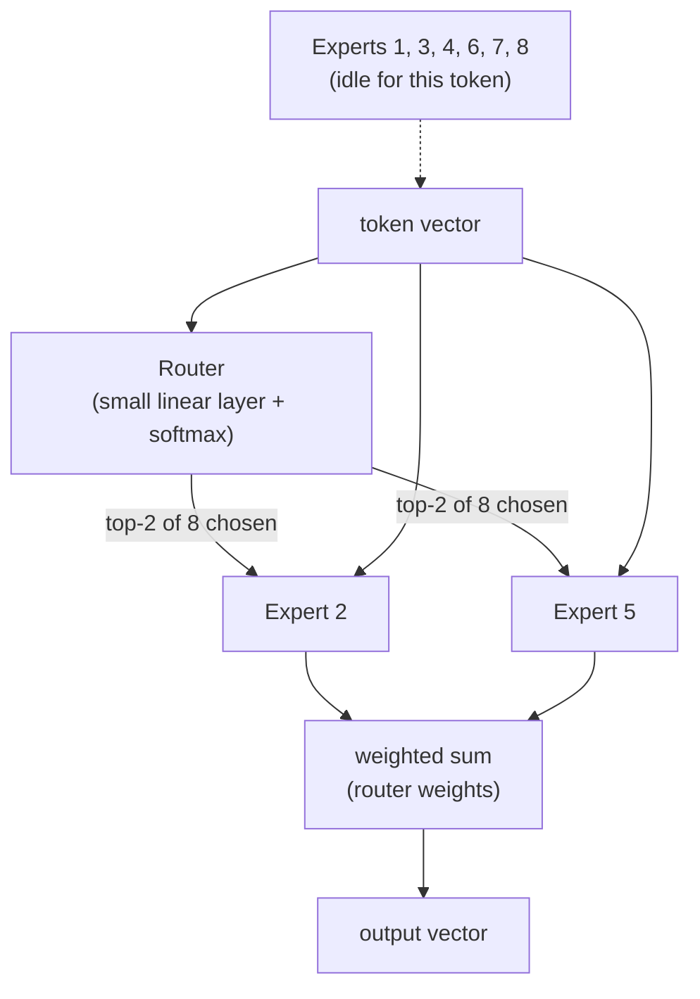
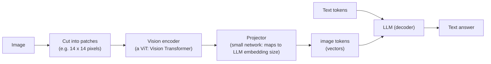

# 07 · Architecture Variants: MoE, Long Context, Multimodal, State-Space Models

## Key idea
The standard dense, text-only Transformer has four pain points, and most architectural innovation since 2017 attacks one of them:

| Pain point | Symptom | Main answers |
|---|---|---|
| Every parameter works on every token | Compute grows with model size | **Mixture of Experts (MoE)** |
| Attention cost grows with `n²`; the KV cache grows with `n` | Long contexts are slow and memory-hungry | **Long-context techniques**: position scaling, sliding windows, KV compression |
| Text only | Cannot read images or audio | **Multimodal** encoders and projectors |
| Attention keeps every past token | Memory per generated token keeps growing | **State-space models (SSMs)** and hybrids |

None of these replace the Transformer. They modify its parts (the MLP, the attention pattern, the input pipeline) or mix it with other layers.

---

## Part 1: Mixture of Experts (MoE)

### Intuition
Instead of one big MLP per block (handout 03), have many smaller **experts** (each an MLP) plus a small **router** that decides, for each token, which few experts handle it. The model has a huge number of parameters in total, but each token only uses a few of them.



MoE replaces the **MLP** only. Attention stays dense and shared.

### Pseudo-code
```text
function moe_layer(x):                      # x: one token's vector
    scores  = router(x)                     # one score per expert
    chosen  = top_k(scores, k)              # e.g. 2 of 8
    weights = softmax(scores[chosen])       # normalize over the chosen only
    return sum(weights[i] * expert[i](x) for i in chosen)
```
Runnable in [`examples/python/moe.py`](../examples/python/moe.py). With 8 experts and k=2 in the toy layer:

```text
tokens routed to each expert: [257, 224, 209, 302, 269, 264, 237, 238]   (sum 2000 = 1000 tokens x 2)
parameters: total 16,512; used per token 4,224 (26%)
```
Tests confirm exactly k experts run per token and that the output equals the manual weighted sum.

### The trade-off: memory vs compute
- **Compute and speed per token** scale with the **active** parameters (the chosen experts).
- **Memory** scales with the **total** parameters, because any expert might be needed, so all must be loaded.

Reported examples (check the model cards): Mixtral 8x7B has about 47B parameters in total and uses about 13B per token. DeepSeek-V3 has 671B in total and uses about 37B per token. MoE therefore buys a "bigger brain for the same per-token cost", paid for with memory and serving complexity (experts are spread across GPUs: *expert parallelism*, handout 05).

### Practical details
- **Load balancing:** without care the router collapses onto a few favorite experts. Training adds a balancing loss (or bias adjustments) so tokens spread evenly.
- **Experts are not human-readable topics.** Do not expect "the math expert" and "the French expert". Observed specialization tends to be subtler (for example, syntactic patterns).
- **Shared experts:** some designs keep one or more experts that every token uses, plus routed ones.
- **Naming trap:** "8x7B" does not mean 56B. Attention layers are shared, so the real total is lower (about 47B for Mixtral 8x7B).
- Fine-tuning and quantizing MoE models is somewhat trickier than dense ones.

---

## Part 2: Long-context techniques

### The problems
1. Attention compute is `O(n²)` in sequence length (handout 03).
2. The KV cache grows linearly with `n` and can exceed the weights (handout 06).
3. The model must handle positions **longer than it saw in training**.
4. Even when it fits, the model may not **use** a long context reliably.

### Technique 1: stretch the positions (RoPE scaling)
Recall RoPE (handout 02): token positions become rotation angles. Beyond the trained length the angles are values the model never saw. **Position interpolation** squeezes the new, longer range back into the trained range by scaling positions:

```text
position' = position × (trained_length / new_length)        # e.g. 4096 / 16384 = 0.25
```
Variants (NTK-aware scaling, YaRN) scale different frequencies differently. Usually a short fine-tune on long text follows. [`examples/python/rope.py`](../examples/python/rope.py) shows the property that makes this work: the attention score depends only on the **relative** offset (same score at positions (3, 0), (50, 47) and (1000, 997)).

### Technique 2: restrict who attends to whom (sliding window)
Let each token attend only to the last `w` tokens. Cost drops from `O(n²)` to `O(n·w)`. Information still travels farther than `w` because layers stack: after `L` layers a token is influenced by about `L·(w-1)+1` positions.

```text
window=4, token 15:   1 layer sees [12..15]   2 layers see [9..15]   3 layers see [6..15]
n=8000: full attention 32,004,000 pairs  vs  window 512: 3,965,184 pairs  (8x fewer)
```
([`examples/python/sliding_window.py`](../examples/python/sliding_window.py).) Some models mix **local** (windowed) layers with occasional **global** (full) layers, to keep cheap long-range links.

### Technique 3: shrink the KV cache
| Method | Idea |
|---|---|
| **GQA / MQA** (grouped- / multi-query attention) | Share K and V across groups of heads (handout 03) |
| **MLA** (multi-head latent attention) | Store a compressed latent vector per token and expand it when needed (used in the DeepSeek models) |
| KV quantization or eviction | Store K/V in fewer bits, or drop tokens that matter little |
| Attention sinks (streaming) | Keep the first few tokens plus a recent window for endless streams; trades away exact memory of the middle |

### Technique 4: exact, faster kernels
FlashAttention (handout 06) makes long sequences practical but does not change the `O(n²)` compute.

### Advertised vs effective context
A model's context window is the maximum it **accepts**. How well it **retrieves and reasons over** information at different positions varies (details in the middle are most at risk), and quality can degrade as prompts approach the limit. Test with your own long inputs, and prefer retrieving only what is relevant (handout 08).

---

## Part 3: Multimodal models

### Intuition
An LLM consumes a sequence of vectors. Anything that can be turned into vectors of the right size can be fed in. For images:


- A **vision encoder** (an encoder-only Transformer, handout 03) turns image patches into vectors.
- A **projector** maps those vectors to the LLM's `d_model`, so they sit in the sequence next to text tokens.
- The LLM then attends over image and text positions alike. Audio works the same way with an audio encoder (speech models like Whisper use an audio encoder, handout 03).

### Design variants
| Approach | How vision joins the LLM |
|---|---|
| Projection (LLaVA-style) | Pretrained vision encoder + projector, then fine-tune |
| Cross-attention (Flamingo-style) | Extra layers where text tokens attend to image features |
| Native multimodal | One model trained from the start on text, images and audio together |

### What developers should know
- **Images cost tokens.** One image is typically hundreds to a few thousand tokens depending on size and the provider's scheme. It counts toward the context window and the bill.
- **Output is usually text.** Generating images or audio is typically done by separate generators (for example diffusion models) or by models with dedicated output heads, not by the next-token text head alone.
- **"Seeing" is not human vision.** Models can misread small text, fine spatial relations, counts and charts. Verify on your own images.

---

## Part 4: State-space models (SSMs) and hybrids

### Intuition
Attention remembers the past by keeping **every** token's key and value. A state-space model instead keeps a **fixed-size state** and updates it for each token, like an RNN (handout 01), but designed so it can still be trained in parallel.

```text
h_t = A · h_(t-1) + B · x_t        # update the state with the new token
y_t = C · h_t                      # read the output from the state
```
`A` below 1 means old information fades smoothly.

### Two equivalent views
- **Recurrent view:** step through tokens one by one with constant memory. Ideal for generation.
- **Convolution view:** the same computation equals a causal convolution of the input with a fixed kernel `K_j = C · (A^j · B)`. This can be computed in parallel, which makes training fast.

[`examples/python/ssm.py`](../examples/python/ssm.py) implements both and a test confirms they give identical outputs:

```text
recurrent == convolution: True
after 100,000 tokens: SSM state = 8 numbers; KV cache grows to 100000 entries per layer
```
**Mamba** makes `A`, `B`, `C` depend on the current input (**selective** SSM), so the model can decide what to keep and what to ignore. The simple fixed version above is only the starting point.

### Trade-offs
| | Attention (Transformer) | SSM (Mamba-style) |
|---|---|---|
| Memory per layer during generation | Grows with context (KV cache) | Constant |
| Compute per generated token | Grows with context | Constant |
| Training | Parallel | Parallel (convolution or scan) |
| Exact recall of an earlier token | Strong (direct lookup) | Weaker: history is **compressed** into the state |
| Ecosystem and tooling | Mature | Younger |

### Hybrids
Because the strengths are complementary, many recent designs **interleave** a few attention layers with many SSM layers (and sometimes MoE layers too, as in Jamba). The attention layers provide precise recall, and the SSM layers provide cheap long-range processing. Related families (RWKV, RetNet, linear attention) pursue the same goal: attention-like quality with recurrent-like inference cost.

---

## Part 5: Other directions to watch
- **Diffusion language models** generate many tokens in parallel by iteratively refining a draft instead of left-to-right. Still experimental for text.
- **Test-time compute:** reasoning models (handouts 01 and 05) are not a new architecture. They spend more inference compute (long thinking) on the same kind of network.
- **Distillation:** training a small model to imitate a large one, often the practical alternative to exotic architectures.

---

## Part 6: What this means for developers
Most of the time you will see architecture only through its **price, speed, and limits**:

| You care about | Look at |
|---|---|
| Cost and latency per token | **Active** parameters (MoE), not total |
| Self-hosting memory | **Total** parameters, plus KV cache size (GQA/MLA help) |
| Long documents | Advertised context, and your own test of effective context |
| Images or audio | Supported inputs, and tokens per image |
| Very long, streaming inputs | Hybrid or SSM models, if recall precision allows |

---

## Pitfalls
- **"MoE 8x7B is a 56B model, and as slow as one."** Shared attention makes it smaller, and per-token compute is that of the active experts.
- **"MoE saves memory."** It saves compute. Memory follows the total parameters.
- **"Longer context window means better answers."** Capacity is not usage, so test retrieval and reasoning at the lengths you need.
- **"SSMs will replace Transformers."** So far they complement them, and hybrids are the common compromise.
- **"Multimodal models see like people."** They process patch embeddings and can fail on fine detail.
- **Treating reported parameter counts as precise.** Providers often do not disclose architectures.

## Summary
- MoE: a router selects a few experts per token, giving large total capacity at the compute of the active subset (memory still follows total).
- Long context: scale positions (RoPE interpolation), limit attention (sliding window, local plus global layers), shrink the KV cache (GQA, MLA), and still verify effective context.
- Multimodal: encode other inputs into vectors with an encoder and a projector, then let the LLM attend over them like tokens.
- SSMs keep a fixed-size state: cheap generation, weaker exact recall. Hybrids combine them with attention.

## Further reading
- Shazeer et al., *Outrageously Large Neural Networks: The Sparsely-Gated Mixture-of-Experts Layer* (2017); Jiang et al., *Mixtral of Experts* (2024)
- Chen et al., *Extending Context Window of Large Language Models via Positional Interpolation* (2023); Peng et al., *YaRN* (2023)
- Beltagy et al., *Longformer* (2020); Jiang et al., *Mistral 7B* (2023)
- Liu et al., *Visual Instruction Tuning* (LLaVA, 2023)
- Gu and Dao, *Mamba: Linear-Time Sequence Modeling with Selective State Spaces* (2023); Lieber et al., *Jamba* (2024)
- Liu et al., *Lost in the Middle* (2023)
