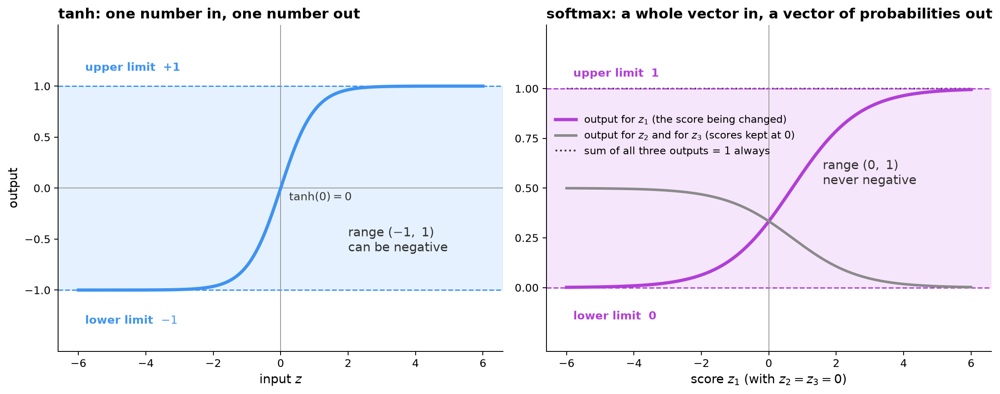
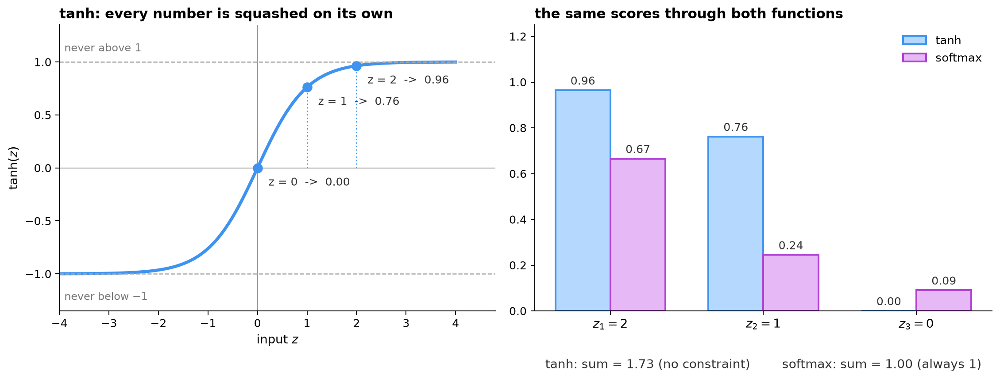

# Appendix A: tanh and softmax

Two functions show up in almost every neural network, and they are easy to confuse: **tanh**, which keeps the values inside a network bounded ([handout 01](01-history.md), the RNN cell), and **softmax**, which turns scores into probabilities ([handout 04](04-generation.md) and the attention weights in [handout 03](03-transformer.md)). They look alike at first glance, because both squash numbers with exponentials, but they do different jobs.

## The difference in one sentence

**tanh works on each number separately. Softmax works on a whole vector, so its outputs compete with each other.**

$$
\tanh(z) = \frac{e^{z} - e^{-z}}{e^{z} + e^{-z}}, \qquad
\mathrm{softmax}(z)_i = \frac{e^{z_i}}{\sum_j e^{z_j}}
$$

The denominator of softmax sums over *all* entries of the vector, so every output depends on every input. tanh has no such sum: the output for $z_i$ depends on $z_i$ only.

*Left: tanh, with output between -1 and 1. Right: softmax over three scores, varying only the first one: every output stays between 0 and 1, and the three always add up to 1.*

## Side by side

| | tanh | softmax |
|---|---|---|
| Input and output | one number to one number, applied element by element | a whole vector to a vector of the same length |
| Output range | each value in $(-1, 1)$ | each value in $(0, 1)$ |
| Relation between outputs | none | they add up to exactly 1 |
| Negative outputs | yes | never |
| Raising one input | only its own output changes | its output rises and all the others fall |
| Adding the same constant to every input | changes the result | changes nothing |
| Role | a nonlinearity that keeps values bounded | turns scores into probabilities |
| Where in an RNN | inside the cell, for the hidden state $h_t$ | at the output, for $y_t$ |

## The same three scores through both

For the scores $z = (2,\ 1,\ 0)$:

| | $z_1 = 2$ | $z_2 = 1$ | $z_3 = 0$ | sum |
|---|---|---|---|---|
| tanh | 0.96 | 0.76 | 0.00 | 1.73 |
| softmax | 0.67 | 0.24 | 0.09 | 1.00 |

A score of 0 stays 0 under tanh. Softmax gives it a small positive probability, because it is only compared with the other scores.

## How they are related

- tanh is a rescaled sigmoid: $\tanh(z) = 2 \sigma(2z) - 1$, where $\sigma(z) = 1/(1 + e^{-z})$.
- Softmax over two entries $(z, 0)$ gives $\sigma(z)$ for the first one. Softmax is the many-entry generalization of the sigmoid.
- Both saturate: for very large inputs the output goes flat, and the training signal (gradient) fades there.

## Why they are not interchangeable

- **Softmax inside the state:** every entry of $h_t$ would have to be positive and the total would have to be 1. The hidden state could no longer carry signs or independent magnitudes.
- **tanh at the output:** the values would not add up to 1, so they could not be read as the probabilities of the next token.
